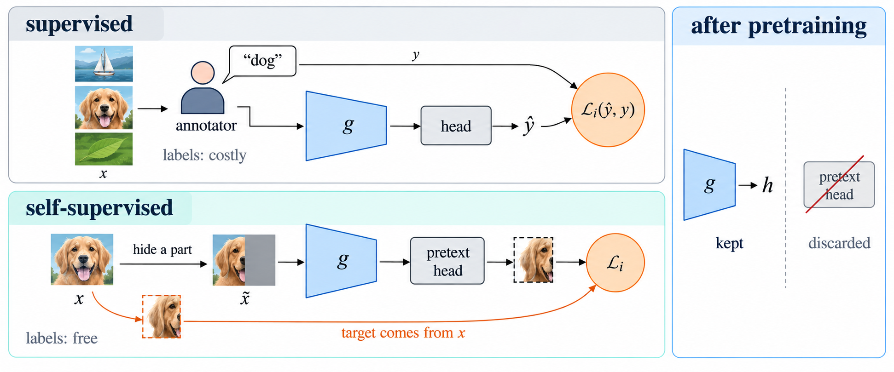
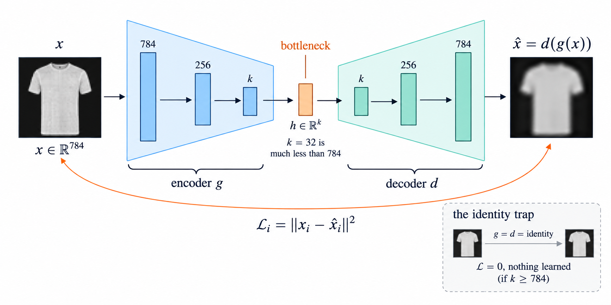
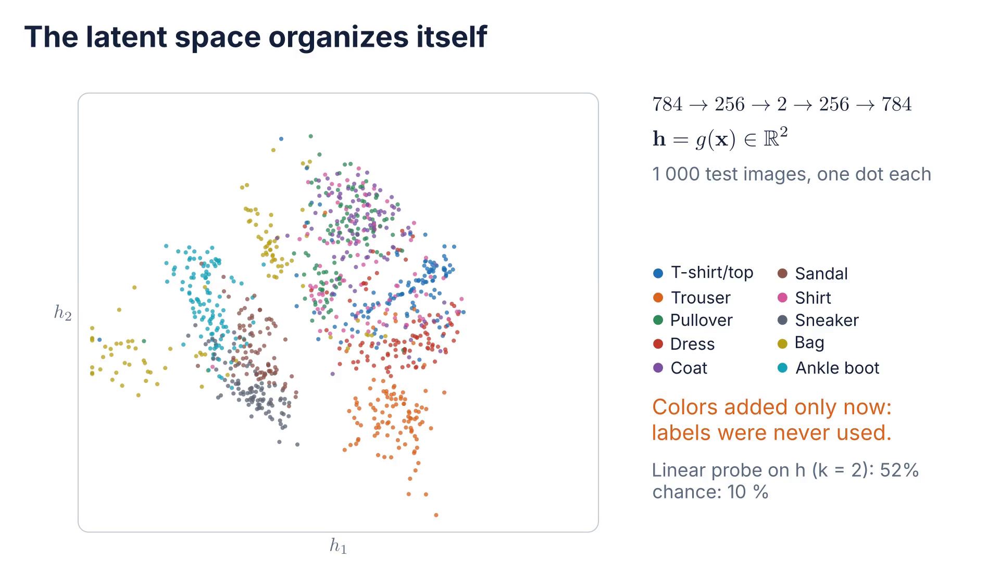
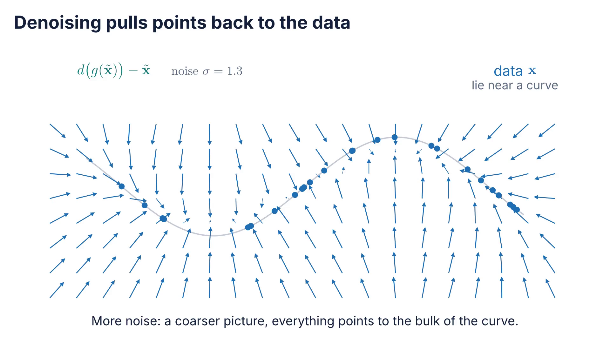
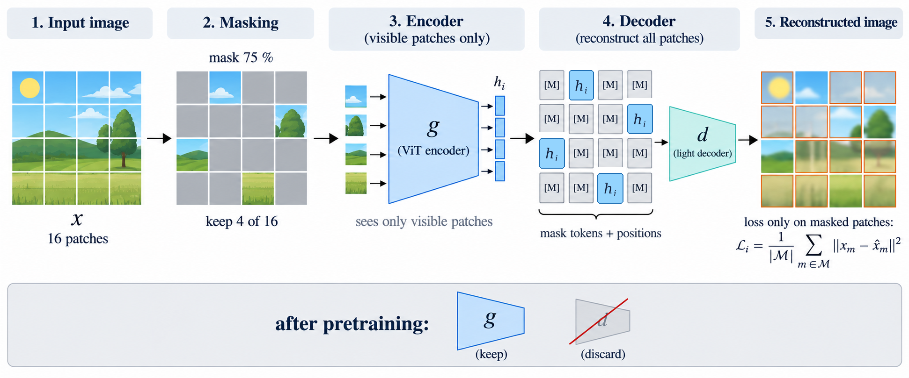
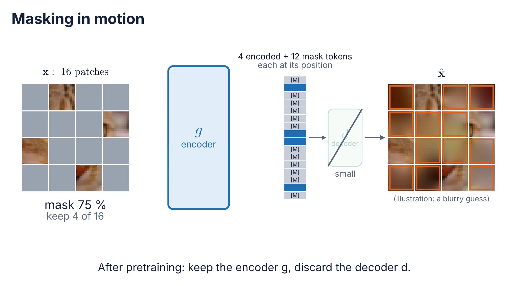
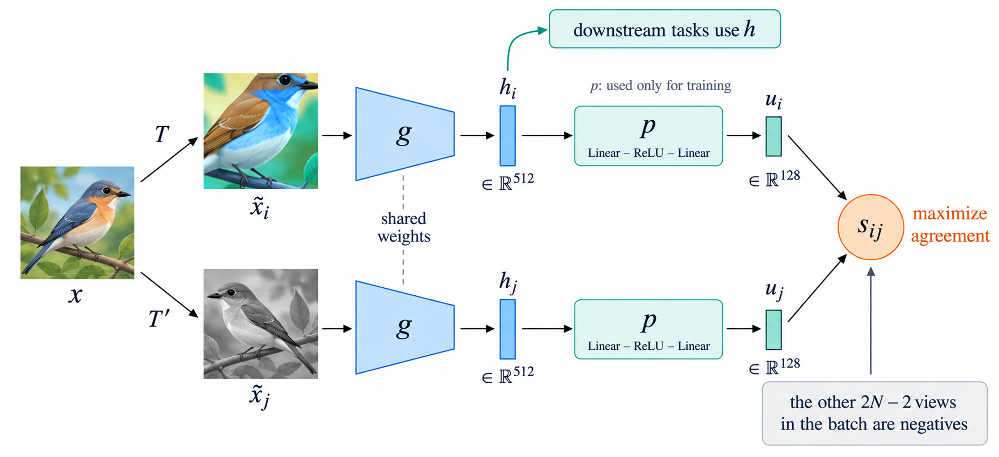
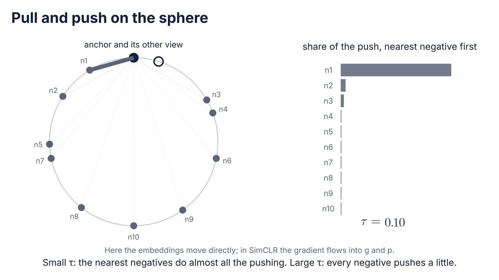
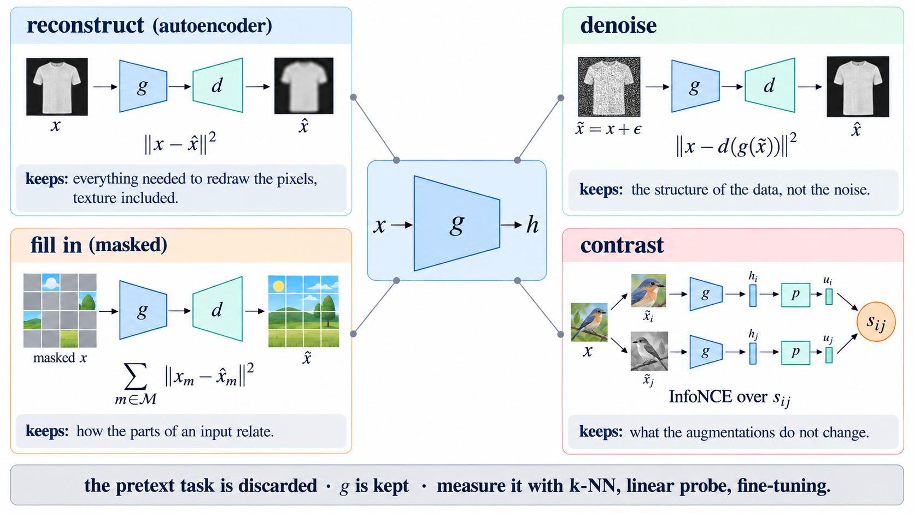

# How can a network learn useful representations without labels?

$$
\mathbf x
\rightarrow
g
\rightarrow
\mathbf h
\rightarrow
\text{reconstruct}
\rightarrow
\text{fill in}
\rightarrow
\text{contrast}
\rightarrow
\text{measure}
$$

---

# Roadmap

1. What is a representation? — and how to measure one
2. Autoencoders — learning by reconstructing the input
3. Masked prediction — learning by filling in what is hidden
4. Contrastive learning — learning which inputs belong together
5. Evaluating representations — $k$-NN, linear probe, fine-tuning

Practice A after Part 2; Practice B after Part 5.

---

# From architecture to representation

Session 03: a backbone $g$ pretrained on ImageNet transfers to new tasks.

$$
\mathbf x \rightarrow g(\mathbf x) = \mathbf h \rightarrow \text{new head} \rightarrow \hat y
$$

But that backbone needed **1.2 million labeled images**.

What did $g$ actually learn, and could it learn it **without** the labels?

---

# The question for today

> **How can a network learn useful representations without explicit labels?**

Labels are scarce and expensive: 300 labeled X-rays (Session 03 exit question).

Unlabeled images are almost free.

Can the data **supervise itself**?

---

# Part 1 · What is a representation?

1. **What is a representation?** — and how to measure one
2. Autoencoders — learning by reconstructing the input
3. Masked prediction — learning by filling in what is hidden
4. Contrastive learning — learning which inputs belong together
5. Evaluating representations — $k$-NN, linear probe, fine-tuning

> Session 03: the architecture is an assumption about the input. Today: the objective is an assumption too.

---

# A representation is a change of coordinates

$$
\mathbf x \in \mathbb R^{D}
\;\longmapsto\;
\mathbf h = g(\mathbf x) \in \mathbb R^{k}
$$

Session 01: the hidden layer bent the input space until **one line** separated the classes.

A good $\mathbf h$ makes the task **easy for a simple model**.

---

# What makes a representation useful

- keeps the information the task needs;
- discards nuisances: lighting, position, background;
- is compact;
- is **linearly decodable**: a linear layer can read the answer.

"Useful" always means **useful for some task**. There is no best $\mathbf h$ in the abstract.

---

# Embeddings

One vector per item; **distance means similarity**.

- Words, users, products: `nn.Embedding` is a lookup table, one-hot $\times$ matrix.
- Images: the output of $g$. For ResNet-18, $\mathbf h \in \mathbb R^{512}$.

Two images are "similar" if their embeddings are close:

$$
\cos(\mathbf h_i, \mathbf h_j) = \frac{\mathbf h_i^\top \mathbf h_j}{\lVert \mathbf h_i \rVert\,\lVert \mathbf h_j \rVert}
$$

---

<!-- _class: figure -->
<!-- _paginate: false -->
<!-- _footer: "" -->

---

# Labels from the data itself

A **pretext task**: hide or alter part of $\mathbf x$, predict it from the rest.

Two families:

- **self-prediction** — reconstruct, denoise, fill in;
- **contrastive** — decide which inputs belong together.

The pretext task is **discarded**. The encoder $g$ is **kept**.

---

# Measuring a representation

Freeze $g$, then read $\mathbf h$ with as little as possible:

1. **linear probe** — one linear layer trained on $\mathbf h$ (Session 03);
2. **$k$-NN** — the label of the nearest embeddings, no training at all;
3. **label efficiency** — accuracy as a function of the number of labels.

Probe accuracy measures **representation quality**, not the encoder's own objective.

---

# Prediction before experiment

A ResNet-18 with **random** weights, frozen.

A linear probe on its $\mathbf h \in \mathbb R^{512}$, trained on CIFAR-10.

Chance is 10 %.

> What accuracy do you expect? Answer in notebook 4.5.

<!-- Expected: well above chance. Random convolutional features already keep local color and edge statistics. -->

---

# Architecture versus objective

| Session | Chooses | Effect on $\mathbf h$ |
|---|---|---|
| 03 | the architecture of $g$ | what $g$ **can** represent |
| 04 | the objective $J$ | what $g$ is **pushed** to represent |

Same ResNet-18, different $J$ → different $\mathbf h$.

---

# Part 2 · Autoencoders

1. What is a representation? — and how to measure one
2. **Autoencoders** — learning by reconstructing the input
3. Masked prediction — learning by filling in what is hidden
4. Contrastive learning — learning which inputs belong together
5. Evaluating representations — $k$-NN, linear probe, fine-tuning

> Part 1: a representation is judged by what a simple model can do with it.

---

# Encoder and decoder

$$
\hat{\mathbf x} = d\big(g(\mathbf x)\big),
\qquad
L_i = \lVert \mathbf x_i - \hat{\mathbf x}_i \rVert^2
$$

The only supervision is the input itself.

**The trap:** $g = d = \text{identity}$ gives $L = 0$ and learns nothing.

Something must prevent copying.

---

<!-- _class: figure -->
<!-- _paginate: false -->
<!-- _footer: "" -->

---

# The bottleneck forces a choice

**Undercomplete:** $k \ll D$, for example $784 \rightarrow 32$.

$g$ cannot pass everything through $\mathbf h$, so it must decide **what to keep**.

Compression is the supervision.

---

# A linear autoencoder is PCA

Linear $g$ and $d$, trained with MSE, learn the subspace of the **top-$k$ principal components**.

Notebook 4.1, Fashion-MNIST, $k = 32$: same test error as PCA (0.015), 31 of 32 directions match.

The only new ingredient of a deep autoencoder is the nonlinearity $\varphi$.

---

# Prediction before experiment

Fashion-MNIST autoencoder, bottleneck $k = 2$ versus $k = 32$.

Which one **reconstructs** better?

In which latent space are the classes **more separated**, judged by a linear probe?

---

<!-- _class: media -->

# The latent space organizes itself

<video controls preload="none" poster="../figures/s04_a01_latent_space_poster.png" aria-label="The latent space organizes itself">
  <source src="../figures/s04_a01_latent_space.mp4" type="video/mp4">
</video>

[Open animation](../figures/s04_a01_latent_space.mp4)

<!-- 2-D code of 1 000 test images over 4 800 training steps; colors added only at the end. Same model and seed as notebook 4.1, section 1: probe on h = 60 %, chance 10 %. -->

<!-- Pending figure S04-F03 (full-slide figure after this slide): reconstructions of 8 test images for k = 2, 8, 32 and PCA k = 32, with test MSE and probe accuracy per row (notebook 4.1, section 4) -->

---

# Reconstruction is not the goal

Pixel MSE spends capacity on texture and gives blurry outputs.

Notebook 4.1, $k = 32$:

| | MSE | probe |
|---|---:|---:|
| PCA | 0.0151 | 0.807 |
| autoencoder (ReLU) | 0.0108 | 0.812 |

28 % less reconstruction error buys **0.6 points** of probe.

---

# Convolutional autoencoder

Encoder: the convolutions of Session 03. Decoder: `ConvTranspose2d`, the way back.

$$
1\times28\times28
\rightarrow 32\times14\times14
\rightarrow 64\times7\times7
\rightarrow \mathbf h \in \mathbb R^{32}
\rightarrow \cdots \rightarrow 1\times28\times28
$$

Notebook 4.2: 40 % fewer parameters than the MLP, better reconstruction, **the same probe**.

---

# Denoising autoencoder

$$
\tilde{\mathbf x} = \mathbf x + \boldsymbol\varepsilon,
\qquad
L_i = \big\lVert \mathbf x_i - d\big(g(\tilde{\mathbf x}_i)\big) \big\rVert^2
$$

The encoder sees the corrupted input; the target is the clean one. Copying is no longer possible.

Notebook 4.2, $k = 32$: clean reconstruction **worse** (0.0114 → 0.0126), probe **better** (0.813 → 0.819).

With noise, even a **wide** code works: $k = 1024$ copies without noise (probe = pixels, 0.846) and learns with a mask (0.871).

---

<!-- _class: media -->

# Denoising pulls points back to the data

<video controls preload="none" poster="../figures/s04_a02_denoising_manifold_poster.png" aria-label="Denoising pulls points back to the data">
  <source src="../figures/s04_a02_denoising_manifold.mp4" type="video/mp4">
</video>

[Open animation](../figures/s04_a02_denoising_manifold.mp4)

<!-- The arrows are the best possible denoiser E[x | x~], which a trained DAE approximates. It lands near the curve, not on the original point. More noise: a coarser field. -->

---

# Other ways to prevent copying

- a narrow bottleneck (undercomplete);
- noise or masks on the input (denoising);
- sparse codes: most units of $\mathbf h$ at zero;
- the generative version, the **VAE**: $\mathbf h$ is a distribution (beyond this course).

Common idea: **limit the information** that can pass through $\mathbf h$.

---

# Practice A — Autoencoders

Worked notebooks on Fashion-MNIST, one change per cell, CPU:

- [4.1 · Autoencoders](../notebooks/sesion_04_1_autoencoders.ipynb): $k = 2$ latent space, $k = 2 \dots 128$, linear AE vs PCA, the identity trap
- [4.2 · Denoising and convolutional](../notebooks/sesion_04_2_denoising_conv.ipynb): noise and masks, $k = 1024$, learned filters, conv AE

> Write down two numbers per model: reconstruction error and probe. Do they move together?

---

# Part 3 · Masked prediction

1. What is a representation? — and how to measure one
2. Autoencoders — learning by reconstructing the input
3. **Masked prediction** — learning by filling in what is hidden
4. Contrastive learning — learning which inputs belong together
5. Evaluating representations — $k$-NN, linear probe, fine-tuning

> Part 2: denoising predicts the clean input from a corrupted one. Masking is the extreme case of corruption.

---

# From noise to masks

Instead of perturbing every pixel, **remove** whole regions.

Predict only what was hidden.

$$
\mathbf x = (\mathbf x_{\text{visible}}, \mathbf x_{\text{masked}}),
\qquad
\text{predict } \mathbf x_{\text{masked}} \text{ from } \mathbf x_{\text{visible}}
$$

---

# Hand-designed pretext tasks

Before masking became the standard:

- predict the **rotation** applied to an image (0°, 90°, 180°, 270°);
- solve a **jigsaw** of shuffled tiles;
- **colorize** a grayscale image;
- **inpaint** a missing square.

Each worked a little, and each had **shortcuts**: low-level cues that solve the task without understanding the image.

---

# Masked autoencoders

1. split the image into patches (Session 03);
2. mask **75 %** of them at random;
3. the encoder $g$ sees **only the visible patches**;
4. a small decoder $d$ receives mask tokens [M] at the hidden positions and fills them in;
5. the loss counts **only the masked patches**:

$$
L_i = \frac{1}{|M|} \sum_{m \in M} \lVert \mathbf x_m - \hat{\mathbf x}_m \rVert^2
$$

---

<!-- _class: figure -->
<!-- _paginate: false -->
<!-- _footer: "" -->

---

<!-- _class: media -->

# Masking in motion

<video controls preload="none" poster="../figures/s04_a03_masking_poster.png" aria-label="Masking in motion">
  <source src="../figures/s04_a03_masking.mp4" type="video/mp4">
</video>

[Open animation](../figures/s04_a03_masking.mp4)

<!-- Same image and patch grid as S03-A04. The output is an illustration (inpainting from the 4 visible patches), not a trained MAE. -->

---

# Why mask so much?

Images are **redundant**: with 25 % masked, a hidden patch can be copied from its neighbors.

Text is not: BERT masks only **15 %** of the words (Session 05).

Bonus: the encoder processes only 25 % of the patches, so pretraining is **several times faster** (about 3× in the MAE paper; 1.7× in notebook 4.3, where the decoder is not much smaller).

How much to mask depends on **how redundant the data are**.

---

# Prediction before experiment

Tiny MAE on Fashion-MNIST: 16 patches of $7 \times 7$, Transformer encoder.

Mask **25 %** or **75 %**.

Which one gives the better **linear probe**?

Which one **trains faster**?

<!-- Notebook 4.3: probe 0.804 (25 %) vs 0.791 (75 %); time 174 s vs 102 s. Each patch is a sixth of a sleeve: little redundancy, so 75 % does not win here. -->

---

# What masked prediction learns

The information is in $\mathbf h$, but **not linearly arranged**:

- MAE paper, ViT-L on ImageNet: the linear probe stays about **10 points** below fine-tuning;
- notebook 4.3, 100 labels per class: probe 0.77, fine-tuning 0.78; pretraining adds **10 points** to the probe over a random encoder.

Masked features shine **after fine-tuning**. Next: an objective whose features read well **linearly**.

---

# Part 4 · Contrastive learning

1. What is a representation? — and how to measure one
2. Autoencoders — learning by reconstructing the input
3. Masked prediction — learning by filling in what is hidden
4. **Contrastive learning** — learning which inputs belong together
5. Evaluating representations — $k$-NN, linear probe, fine-tuning

> Part 3: self-prediction spends effort on pixels. Alternative: no decoder at all.

---

# Learning relations, not pixels

In embedding space:

- **similar** inputs → close;
- **dissimilar** inputs → far.

No reconstruction, no decoder.

The question is no longer "what is in this image?" but "**is this the same image?**"

---

# Augmentations define "the same"

Two random views of one image $\mathbf x$:

$$
\tilde{\mathbf x}_i = t(\mathbf x),\quad \tilde{\mathbf x}_j = t'(\mathbf x),\qquad t, t' \sim \mathcal T
$$

are a **positive pair**.

The augmentations chosen are the **invariances learned**: whatever $\mathcal T$ changes, $\mathbf h$ learns to ignore.

Session 03: augmentation encodes invariances. Here it is the **only** supervision.

<!-- Pending figure S04-F05 (full-slide figure after this slide): eight CIFAR-10 images, each with two SimCLR views (notebook 4.4, section 1: vistas_ejemplo.npz) -->

---

# SimCLR

For a batch of $N$ images:

1. two views of each image: $2N$ views;
2. shared encoder: $\mathbf h = g(\tilde{\mathbf x})$;
3. projection head: $\mathbf u = p(\mathbf h)$;
4. each view must find **its** other view among the other $2N - 1$.

The other $2N - 2$ views are the **negatives**.

---

<!-- _class: figure -->
<!-- _paginate: false -->
<!-- _footer: "" -->

---

# Similarity and temperature

$$
s_{ij} = \frac{\mathbf u_i^\top \mathbf u_j}{\tau\,\lVert\mathbf u_i\rVert\,\lVert\mathbf u_j\rVert}
$$

Cosine similarity, divided by a **temperature** $\tau$.

Small $\tau$ sharpens the comparison and focuses on the **hardest negatives**: the ones that are most similar.

---

# InfoNCE is a cross-entropy

$$
L_i = -\log \frac{\exp\big(s_{i,j(i)}\big)}{\sum_{k \ne i} \exp(s_{ik})}
$$

A classification over $2N - 1$ candidates, where the correct "class" is the other view $j(i)$.

The same softmax + cross-entropy as Session 01. At initialization, $L \approx \ln(2N - 1)$.

<!-- Pending figure S04-F07 (full-slide figure after this slide): 2N × 2N similarity matrix for N = 8 from the trained checkpoint, positives marked, one row read as softmax (notebook 4.4, section 5: similitud_n8.npz) -->

---

<!-- _class: media -->

# Pull and push on the sphere

<video controls preload="none" poster="../figures/s04_a04_contrastive_sphere_poster.png" aria-label="Pull and push on the sphere">
  <source src="../figures/s04_a04_contrastive_sphere.mp4" type="video/mp4">
</video>

[Open animation](../figures/s04_a04_contrastive_sphere.mp4)

<!-- Exact InfoNCE gradient descent on the unit circle, tau = 0.2: J from 5.08 to 0.29. Then each negative's share of the push while tau goes from 1.0 to 0.1. -->

---

# Prediction before experiment

Train SimCLR **without color jitter**.

The pretext task: easier or harder? Does the loss end lower or higher?

The representation: does the $k$-NN accuracy go up or down?

Second question: $\tau = 0.05$ versus $\tau = 1.0$.

<!-- Without color jitter, two crops of one photo share their color histogram: the network matches them by color and never needs shapes. Easier pretext task, worse h (SimCLR paper, section 3; notebook 4.4, section 6). -->

---

# Why a projection head?

The loss makes $\mathbf u$ **invariant** to the augmentations, so $\mathbf u$ throws information away: color, orientation, position.

$\mathbf h$, one layer earlier, keeps more of it.

Downstream we use $\mathbf h$ and **discard** $p$.

---

# Negatives and batch size

More negatives → a harder task → better features.

SimCLR needs **large batches**: $N = 512$ gives 1 023 candidates per view.

MoCo keeps a **queue** of past embeddings instead, so the negatives do not have to fit in one batch.

---

# Collapse

If every $\mathbf u$ is the same, the two views of an image always match.

**Negatives prevent this:** a constant $\mathbf u$ cannot be far from the other images.

Methods **without** negatives (BYOL, DINO) prevent collapse with asymmetry: a second network updated slowly, and no gradient through one branch.

Symptom to watch: the variance of $\mathbf h$ across a batch goes to zero.

---

# The same idea, other pairs

| Method | Positive pair | Against collapse |
|---|---|---|
| SimCLR | two views of one image | negatives in the batch |
| MoCo | two views of one image | a queue of negatives |
| BYOL, DINO | two views of one image | slow teacher network |
| CLIP | an image and its **caption** | negatives in the batch |

CLIP is a **foundation model**: Session 05.

---

# Part 5 · Evaluating representations

1. What is a representation? — and how to measure one
2. Autoencoders — learning by reconstructing the input
3. Masked prediction — learning by filling in what is hidden
4. Contrastive learning — learning which inputs belong together
5. **Evaluating representations** — $k$-NN, linear probe, fine-tuning

> Part 4: three objectives — reconstruct, fill in, contrast — and one encoder $g$.

---

# Three ways to read a representation

| Reading | What is trained | What it measures |
|---|---|---|
| $k$-NN | nothing | neighborhoods in $\mathbf h$ |
| linear probe | one linear layer | linear decodability |
| fine-tuning | everything | $g$ as a starting point |

The same three strategies as Session 03, now applied to **our own** $g$.

---

# $k$-NN in embedding space

For a new image: find the $k$ training images with the most similar $\mathbf h$ (cosine), and vote their labels.

No training, no hyperparameters beyond $k$.

It is also **retrieval**: "show me images like this one".

<!-- Pending figure S04-F08 (full-slide figure after this slide): 5 query images and their 6 nearest training neighbors with SimCLR h, green frame same class, red other (notebook 4.5, section 2: recuperacion_simclr.npz) -->

---

# Label efficiency

The question that justifies self-supervision:

> How much accuracy per label?

Notebook 4.5: linear probe with 1, 10, 100, 1000 and 5000 labels per class, for four ResNet-18 encoders — random, autoencoder, SimCLR, ImageNet.

The gap at the **left** of the curve is the value of the unlabeled images.

<!-- Pending figure S04-F09 (full-slide figure after this slide): probe accuracy vs labels per class (1, 10, 100, 1000, 5000) for random, autoencoder, SimCLR and ImageNet encoders (notebook 4.5, section 4: resultados_eficiencia.json) -->

---

# Looking at embeddings

t-SNE and UMAP keep **neighbors**, not distances.

- cluster sizes mean nothing;
- the gaps between clusters mean nothing;
- another seed gives another picture.

Use them to **look**. Use the probe and $k$-NN to **measure**.

<!-- Pending figure S04-F10 (full-slide figure after this slide): t-SNE of 2 000 CIFAR-10 test embeddings for random g, autoencoder and SimCLR (notebook 4.5, section 5: embeddings_test.npz) -->

---

# Prediction before experiment

You have the SimCLR encoder and **10 labels per class**: 100 images in total.

Which wins on the test set?

- $k$-NN on $\mathbf h$;
- linear probe on $\mathbf h$;
- fine-tuning all of $g$ with a new head.

> And why? Answer in notebook 4.5, section 6.

---

# Practice B — Contrastive learning and evaluation

Worked notebooks on CIFAR-10, GPU:

- [4.4 · SimCLR](../notebooks/sesion_04_4_simclr.ipynb): two views, InfoNCE checked against the formula, 3 epochs live, the 100-epoch checkpoint, the color shortcut
- [4.5 · Evaluating representations](../notebooks/sesion_04_5_evaluar_representaciones.ipynb): $k$-NN, retrieval, probe, label efficiency, t-SNE, 10 labels per class

At home: [4.3 · Masked prediction](../notebooks/sesion_04_3_masked_prediction.ipynb), a tiny MAE on Fashion-MNIST.

> On Kaggle, add the dataset `si7011-s04-simclr` before running 4.4.

---

# Integrating exercise — EuroSAT without labels

[4.6 · Integrating exercise](../notebooks/sesion_04_6_integrador_eurosat_ssl.ipynb) · the satellite images of Session 03, the same split and contract

- design the two views for satellite images, write InfoNCE;
- pretrain SimCLR on the images **without their labels**, logged to **MLflow**;
- evaluate with $k$-NN and probe using **1 %** and **10 %** of the labels, against ImageNet;
- `embed_raw`: an embedding service for new raw images.

> With few labels: photos **with** labels, or satellite images **without** them?

---

# Choosing a pretext task

| Objective | Learns | Needs | Reads best with |
|---|---|---|---|
| autoencoder | what is needed to redraw pixels | a bottleneck | — |
| denoising | the structure of the data | a corruption | probe |
| masked | how parts relate | a decoder, redundancy | fine-tuning |
| contrastive | what augmentations do not change | good augmentations, many negatives | $k$-NN, probe |

---

# What each objective assumes

| | Assumes | Pays with |
|---|---|---|
| reconstruction | every pixel matters | capacity spent on texture |
| denoising | the noise is not the signal | the noise we chose |
| masked prediction | parts predict parts | features that need fine-tuning |
| contrastive | augmentations do not change meaning | the augmentations we chose |

---

<!-- _class: figure -->
<!-- _paginate: false -->
<!-- _footer: "" -->

---

# Exit question

50 000 unlabeled dermatology images, 200 labeled.

Choose two and justify:

- SimCLR with the default augmentations;
- a masked autoencoder;
- ImageNet backbone + linear probe;
- a denoising autoencoder;
- first check what color jitter does to a skin lesion, then pretrain.
