# How does a network remember the past?

<div class="center">

$$
\mathbf x_1, \mathbf x_2, \dots, \mathbf x_T
\rightarrow
\mathbf h_t
\rightarrow
\mathbf c_t
\rightarrow
\mathbf e_w
\rightarrow
\alpha_{\tau t}
\rightarrow
\hat y
$$

</div>

---

# Roadmap

1. Sequences as data — windows, splits and the baseline to beat
2. Recurrence and its gradients — one cell, many steps
3. Memory that lasts — LSTM and GRU
4. Text as a sequence — tokens, embeddings, order
5. Sequence to sequence — and the first form of attention

Practice A after Part 3; Practice B after Part 5.

---

# From fixed inputs to sequences

Sessions 03 and 04: the **architecture** and the **objective** shape the representation $\mathbf h = g(\mathbf x)$.

So far every input had a **fixed size**: 28×28, 32×32, 64×64.

Now the length changes, and the **order** of the steps carries the information.

---

# The question for today

> **How does a network remember the past?**

It sees one step at a time.

- What should it keep from the steps before?
- How does the gradient reach a step that happened long ago?

---

# Part 1 · Sequences as data

1. **Sequences as data** — windows, splits and the baseline to beat
2. Recurrence and its gradients — one cell, many steps
3. Memory that lasts — LSTM and GRU
4. Text as a sequence — tokens, embeddings, order
5. Sequence to sequence — and the first form of attention

> Session 03: the architecture is an assumption about the input. Today the assumption is about **time**.

---

# Order matters

Text, sensors, audio, prices, gait, heart rate.

Shuffle the steps and the meaning can disappear: "not good, but fun" ≠ "good, but not fun".

Session 03: shuffling the pixels hurt the CNN, not the MLP. An architecture that ignores order **cannot** use it.

---

# Tasks on sequences

| Task | Input → output | Example |
|---|---|---|
| many-to-one | sequence → one value | sentiment of a review, next temperature |
| aligned many-to-many | one output per step | tagging each word, anomaly per reading |
| sequence-to-sequence | sequence → another sequence | translation, date conversion |
| one-to-many | one input → sequence | generating text from a start |

Today: many-to-one in Parts 1–4, sequence-to-sequence in Part 5.

---

<!-- _class: figure -->
<!-- _paginate: false -->
<!-- _footer: "" -->


---

# From a series to examples

Jena Climate: 14 variables (temperature, pressure, humidity, wind…) every **10 minutes**, 2009–2016.

A **sliding window** turns one long series into many examples:

$$
\underbrace{\mathbf x_{t-T+1}, \dots, \mathbf x_t}_{T \text{ past steps}}
\;\longmapsto\;
y = \text{temperature at } t + H_{\text{fut}}
$$

Notebook 5.1: one reading per hour, $T = 120$ hours (5 days), $H_{\text{fut}} = 24$ hours.

---

<!-- _class: figure -->
<!-- _paginate: false -->
<!-- _footer: "" -->

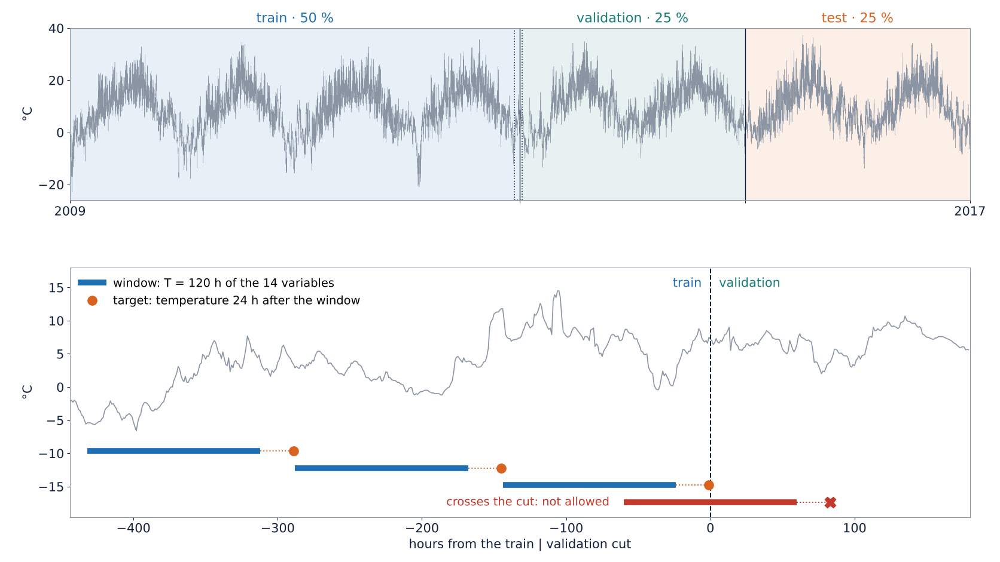

<!-- Notebook 5.1, section 3: 34 732 train windows, 17 080 validation, 17 224 test (windows that would jump one of the 4 hourly gaps are dropped). Baseline MAE 2.44 °C (validation), 2.62 °C (test). -->

---

# Three ways to leak the future

1. **Shuffle before splitting.** Neighboring windows overlap almost completely; one lands in train, its twin in validation.
2. **Normalize with the whole series.** The mean and the scale of the test years enter the training data.
3. **Windows that cross a cut.** The input lives in train, the target in validation.

Each one gives a validation score the test will not repeat.

> The data contract of the S02–S04 integrators, now with time in it: **fit everything on the past only.**


---

<!-- _class: figure -->
<!-- _paginate: false -->
<!-- _footer: "" -->

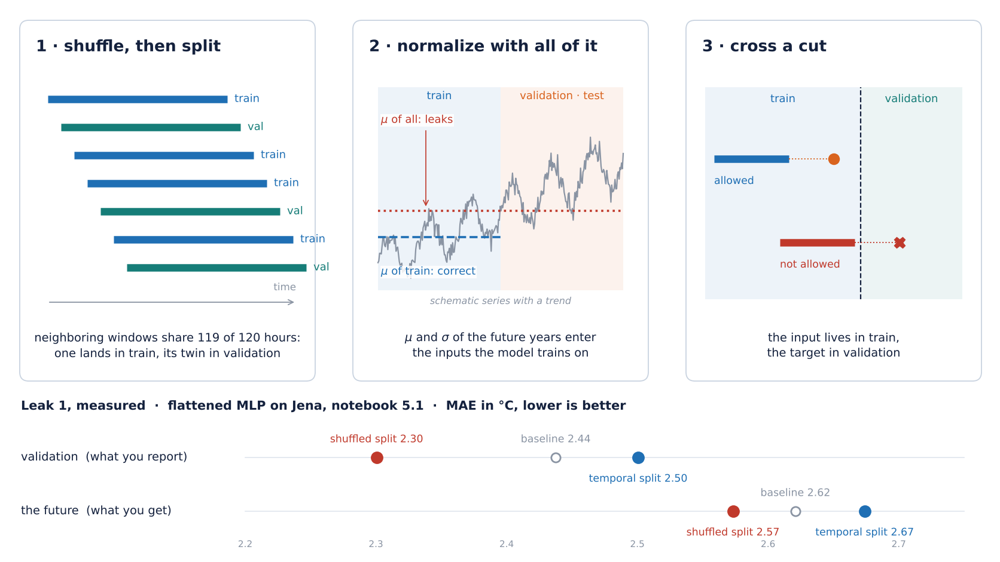

<!-- Script make_s05_figuras_notebooks.py (F12), from resultados_jena_51.json of notebook 5.1. Shuffled split: validation 2.30 °C, better than the baseline (2.44); the same model on the future 2.57 °C, about the baseline there (2.62). Panel 2 is schematic: on Jena that leak is small (Tu turno of 5.1). -->

---

# Prediction before experiment

Jena, 5 days of hourly readings → temperature in 24 h.

<div class="twocol">

<div>

**Commonsense baseline:** the temperature in 24 h equals the temperature now.

</div>

<div>

**Flattened MLP:** $120 \times 14 = 1680$ inputs, two hidden layers.

</div>

</div>

Which one has the lower validation MAE? Answer in notebook 5.1.

---

# Why not an MLP or a CNN?

**Flattened MLP**: parameters grow with $T$; nothing is shared across time; order is only a position in a vector.

**1-D convolution** (Session 03 along time): shares weights, but sees a fixed receptive field.

What we want:

- the **same weights at every step**;
- a **summary** of everything seen so far, of fixed size.

---

# Part 2 · Recurrence and its gradients

1. Sequences as data — windows, splits and the baseline to beat
2. **Recurrence and its gradients** — one cell, many steps
3. Memory that lasts — LSTM and GRU
4. Text as a sequence — tokens, embeddings, order
5. Sequence to sequence — and the first form of attention

> Part 1: a series becomes windows, split by time; the baseline sets the bar.

---

# The recurrent cell

$$
\mathbf h_t = \varphi\big(W_{xh}\,\mathbf x_t + W_{hh}\,\mathbf h_{t-1} + \mathbf b\big),
\qquad \mathbf h_0 = \mathbf 0
$$

- the **same** $W_{xh}$, $W_{hh}$, $\mathbf b$ at every step: weight sharing along time;
- $\mathbf h_t$ summarizes $\mathbf x_{1:t}$ in a vector of fixed size;
- many-to-one: $\hat y = \mathbf w^\top \mathbf h_T + b_{\text{out}}$.

Parameters do not depend on $T$.

---

<!-- _class: media -->

# Unrolling through time

<video controls preload="none" poster="../figures/s05_a01_unrolling_bptt_poster.png" aria-label="Unrolling through time">
  <source src="../figures/s05_a01_unrolling_bptt.mp4" type="video/mp4">
</video>
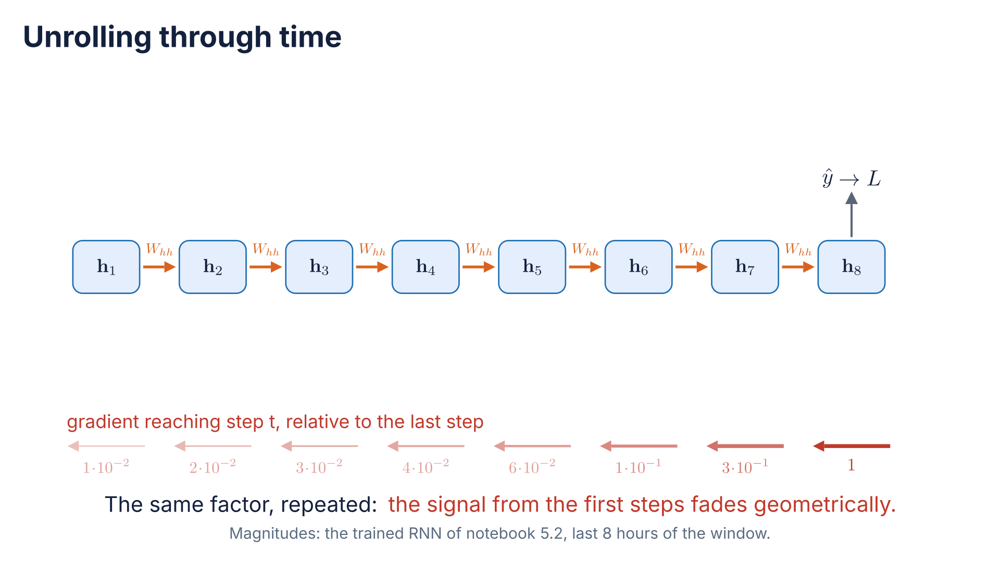

[Open animation](../figures/s05_a01_unrolling_bptt.mp4)

<!-- The cell rolled up, then unrolled over 8 steps with the same W_hh; the gradient flows back from step 8 and weakens step by step. Magnitudes: trained RNN of notebook 5.2, last 8 hours (1, 0.3, 0.1, … 0.01). -->

---

# Shapes in PyTorch

```python
rnn = nn.RNN(input_size=14, hidden_size=16, batch_first=True)
out, h_T = rnn(x)          # x: (B, T, 14)
# out: (B, T, 16)  every h_t      h_T: (1, B, 16)  the last one
y_hat = head(out[:, -1])   # many-to-one: read h_T
```

Notebook 5.2 writes the cell as a Python loop over $t$ and checks that it gives the same `out` as `nn.RNN`.

---

# Backpropagation through time

The unrolled graph is a **deep network with tied weights**: one layer per step.

$$
\frac{\partial \mathbf h_T}{\partial \mathbf h_t}
=
\prod_{k=t+1}^{T}
\frac{\partial \mathbf h_k}{\partial \mathbf h_{k-1}}
=
\prod_{k=t+1}^{T}
\operatorname{diag}\!\big(\varphi'(\mathbf z_k)\big)\, W_{hh}
$$

Session 02: depth was a product of Jacobians. Here it is the **same matrix**, $T - t$ times.

---

# Vanishing and exploding

$$
\left\lVert \frac{\partial \mathbf h_T}{\partial \mathbf h_t} \right\rVert
\le
\big(\gamma\, \lVert W_{hh} \rVert\big)^{T-t},
\qquad \gamma = \max \lvert \varphi' \rvert
$$

- $\gamma \lVert W_{hh}\rVert < 1$: the signal from step $t$ **fades geometrically**;
- large $\lVert W_{hh}\rVert$: the product can **explode**.

With tanh, $\gamma = 1$ and $\varphi' < 1$ away from zero: fading is the usual case.

<span class="small">Bengio, Simard & Frasconi (1994); Pascanu, Mikolov & Bengio (2013).</span>

---

<!-- _class: figure -->
<!-- _paginate: false -->
<!-- _footer: "" -->


<!-- Notebook 5.2, section 3: 16-unit tanh RNN, MAE 2.33 °C vs baseline 2.44 °C. 12 h back the gradient is 1e-3 of the last hour, 48 h back 9e-10; for the first 13 hours it is exactly 0 in float32. Trained with 1 day or 5 days of input: same MAE (2.33 °C). -->

---

# Prediction before experiment

Same Jena windows, a recurrent network with 16 units.

<div class="twocol">

<div>

Does it beat the **commonsense baseline**? And the flattened MLP?

</div>

<div>

With a window of **1 day** instead of 5, does it get better, worse, or stay the same?

</div>

</div>

Answer in notebook 5.2.

---

# Gradient clipping

If $\lVert \nabla_\theta L \rVert > c$, rescale it to norm $c$:

```python
loss.backward()
torch.nn.utils.clip_grad_norm_(model.parameters(), max_norm=1.0)
optimizer.step()
```

It stops **explosions**. It does nothing for **fading**: a small gradient stays small.

Session 02: read the gradient norm before choosing a fix.

---

# Truncated BPTT

For very long sequences, backpropagate only $k$ steps and carry the state forward **detached**:

```python
h = h.detach()   # the next chunk starts from h, but no gradient flows back into it
```

Cheaper in memory, and it limits **by design** how far back the network can learn.


---

<!-- _class: figure -->
<!-- _paginate: false -->
<!-- _footer: "" -->

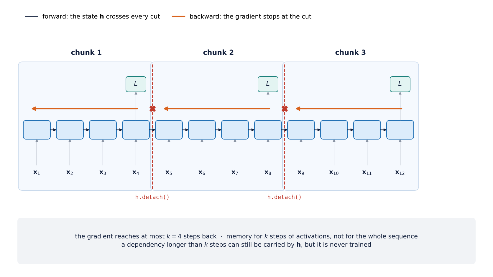

<!-- Script make_s05_f16_f18_parte3.py, drawn (no data). -->

---

# What we need

A path along time where the gradient is **not** multiplied by $W_{hh}$ at every step.

Session 02 had the answer for depth:

$$
\mathbf x_{l+1} = \mathbf x_l + F(\mathbf x_l)
\qquad\Rightarrow\qquad
\frac{\partial \mathbf x_{l+1}}{\partial \mathbf x_l} = I + \frac{\partial F}{\partial \mathbf x_l}
$$

An **additive** path. Part 3 puts one along time.

---

# Part 3 · Memory that lasts: LSTM and GRU

1. Sequences as data — windows, splits and the baseline to beat
2. Recurrence and its gradients — one cell, many steps
3. **Memory that lasts** — LSTM and GRU
4. Text as a sequence — tokens, embeddings, order
5. Sequence to sequence — and the first form of attention

> Part 2: the repeated product of Jacobians wipes out the past.

---

# An additive path for memory

The LSTM keeps a second state, the **cell** $\mathbf c_t$:

$$
\mathbf c_t = \mathbf f_t \odot \mathbf c_{t-1} + \mathbf i_t \odot \tilde{\mathbf c}_t,
\qquad
\tilde{\mathbf c}_t = \tanh\big(W_c[\mathbf h_{t-1}, \mathbf x_t] + \mathbf b_c\big)
$$

Addition instead of multiplication by $W_{hh}$: the residual of Session 02, **along time**.

With $\mathbf f_t \approx \mathbf 1$: $\;\partial \mathbf c_t / \partial \mathbf c_{t-1} \approx I$.

<span class="small">Hochreiter & Schmidhuber (1997); forget gate: Gers, Schmidhuber & Cummins (2000).</span>

---

<!-- _class: figure -->
<!-- _paginate: false -->
<!-- _footer: "" -->

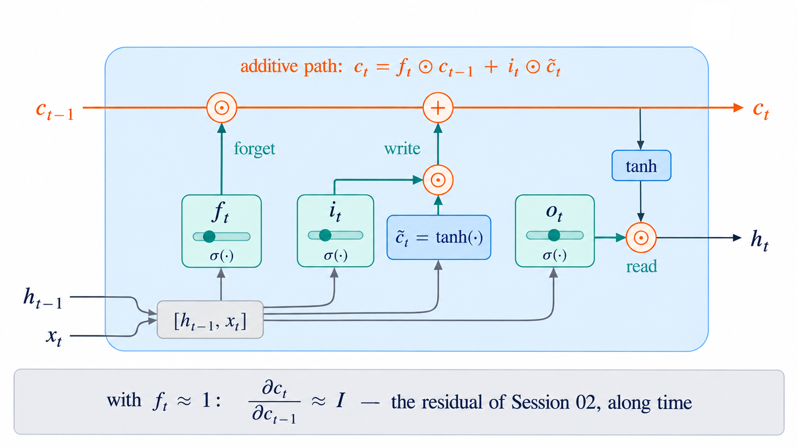

<!-- Generated image, patched by fix_s05_f04_lstm_cell.py: the generator drew a second h_t leaving straight from the c_t line, which would mean h_t = c_t. -->

---

# Three gates

$$
\mathbf f_t, \mathbf i_t, \mathbf o_t
=
\sigma\big(W_{f,i,o}\,[\mathbf h_{t-1}, \mathbf x_t] + \mathbf b_{f,i,o}\big)
\in (0, 1)^{d_h}
$$

| Gate | Decides |
|---|---|
| forget $\mathbf f_t$ | how much of $\mathbf c_{t-1}$ to keep |
| input $\mathbf i_t$ | how much of the new candidate to write |
| output $\mathbf o_t$ | how much of the memory to show: $\mathbf h_t = \mathbf o_t \odot \tanh(\mathbf c_t)$ |

A gate is a **learned multiplier that depends on the input**. Common trick: forget bias initialized to 1, so memory is kept from the start.

---

<!-- _class: media -->

# The memory in motion

<video controls preload="none" poster="../figures/s05_a02_lstm_memory_poster.png" aria-label="The memory in motion">
  <source src="../figures/s05_a02_lstm_memory.mp4" type="video/mp4">
</video>
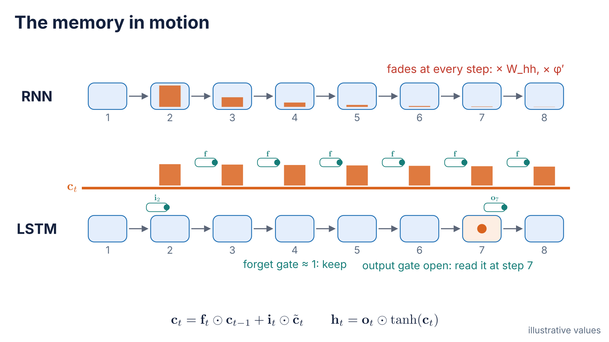

[Open animation](../figures/s05_a02_lstm_memory.mp4)

<!-- A value enters at step 2. In the RNN it fades at every step; in the LSTM the input gate writes it into c_t, the forget gate (≈ 1) keeps it and the output gate reads it at step 7. Illustrative values. -->

---

# GRU

Two gates, no separate cell (Cho et al., 2014):

$$
\mathbf h_t = (1 - \mathbf u_t) \odot \mathbf h_{t-1} + \mathbf u_t \odot \tilde{\mathbf h}_t
$$

- update gate $\mathbf u_t$: interpolates old and new; the additive path is still there;
- reset gate $\mathbf r_t$: how much of $\mathbf h_{t-1}$ enters the candidate $\tilde{\mathbf h}_t$.

Three blocks of weights instead of four: about **3/4** of the LSTM parameters. Often similar results; choose on validation, not by habit.


---

<!-- _class: figure -->
<!-- _paginate: false -->
<!-- _footer: "" -->

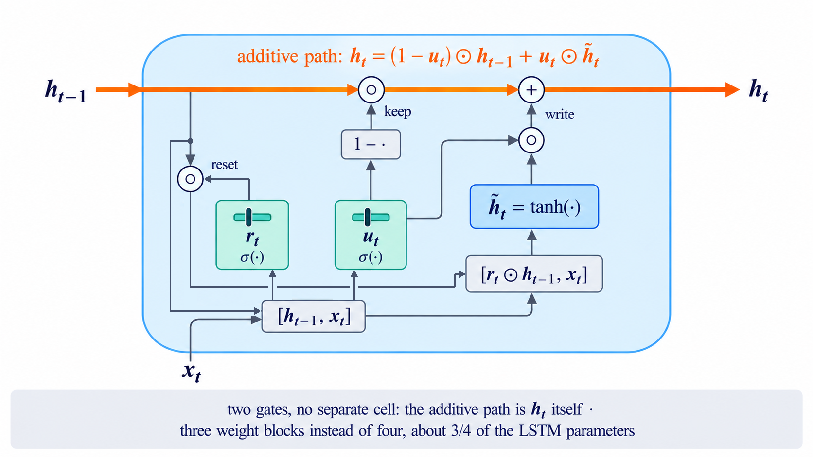

<!-- Generated image, patched by fix_s05_f15_gru_cell.py: the generator sent the reset product into r_t; now r_t multiplies h_{t-1} and the result feeds the candidate. -->

---

# Prediction before experiment

Notebook 5.3: LSTM and GRU on the same Jena windows, same hidden size, same budget.

<div class="twocol">

<div>

Do they beat the RNN and the baseline? By how much?

</div>

<div>

Does the gradient-vs-time plot of F03 change **shape**, or only height?

</div>

</div>

---

<!-- _class: figure -->
<!-- _paginate: false -->
<!-- _footer: "" -->

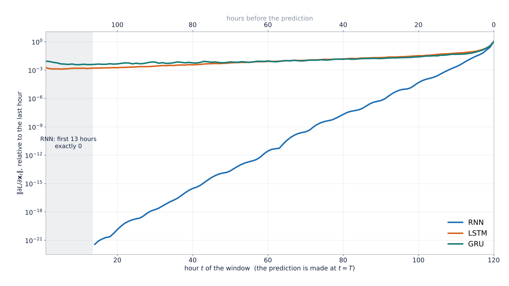

<!-- Notebook 5.3, section 4. Validation MAE: RNN 2.33, LSTM 2.32, GRU 2.30 °C; LSTM with 1 day of input 2.30 °C. The gradient reaches five days back, but this task does not need it: the additive path matters when the task depends on the far past (Parts 4 and 5). -->

---

# Stacked and bidirectional

**Stacked**: $\mathbf h_t$ of layer 1 is $\mathbf x_t$ of layer 2. `nn.LSTM(..., num_layers=2)`.

**Bidirectional**: one pass forward, one backward, states concatenated. `bidirectional=True`.

Bidirectional reads the **whole input** before predicting:

- text classification: fine, the review is complete;
- forecasting: fine *inside* the window, never beyond its end.


---

<!-- _class: figure -->
<!-- _paginate: false -->
<!-- _footer: "" -->

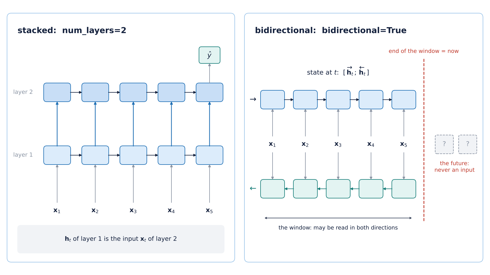

<!-- Script make_s05_f16_f18_parte3.py, drawn (no data). -->

---

# Regularizing recurrent networks

- dropout on the inputs and outputs of the cell;
- dropout on the recurrent connection with the **same mask at every step** (Gal & Ghahramani, 2016); a new mask per step destroys the memory;
- weight decay and early stopping, as in Session 02;
- gradient clipping, always on.

<span class="small">`nn.LSTM(dropout=p)` applies dropout only between stacked layers, not on the recurrent connection.</span>


---

<!-- _class: figure -->
<!-- _paginate: false -->
<!-- _footer: "" -->

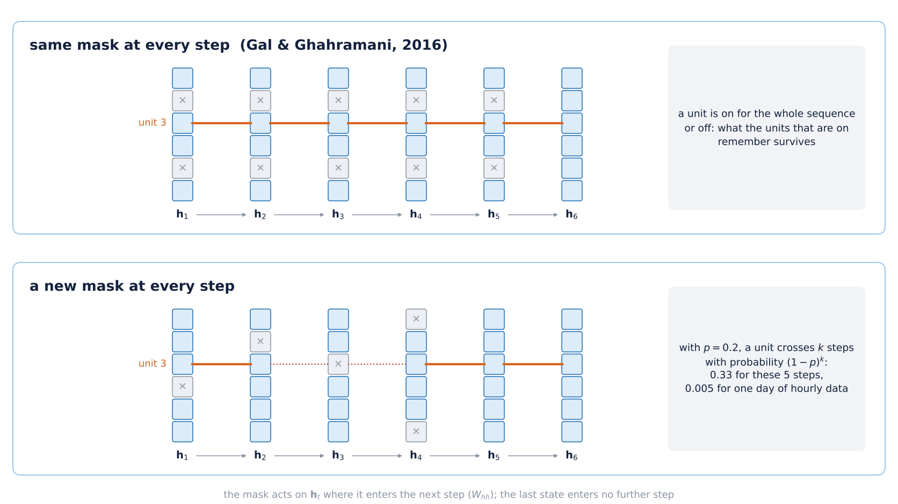

<!-- Script make_s05_f16_f18_parte3.py, drawn (no data). (1 - 0.2)^5 = 0.33, (1 - 0.2)^24 = 0.005. -->

---

# Practice A — Recurrent networks on Jena

Worked notebooks, one change per cell, GPU recommended:

- [5.1 · Series and windows](../notebooks/sesion_05_1_series_ventanas.ipynb): the three leaks, shown and fixed; baseline; flattened MLP; 1-D CNN
- [5.2 · RNN and BPTT](../notebooks/sesion_05_2_rnn_bptt.ipynb): the cell as a loop, gradient vs $t$, clipping, 1 day vs 5 days
- [5.3 · LSTM and GRU](../notebooks/sesion_05_3_lstm_gru.ipynb): the LSTM cell as a loop, same windows, the gradient plot for the three cells, 1 day vs 5 days, stacking

> Keep one table: model, parameters, validation MAE, MAE minus baseline.

---

# Part 4 · Text as a sequence

1. Sequences as data — windows, splits and the baseline to beat
2. Recurrence and its gradients — one cell, many steps
3. Memory that lasts — LSTM and GRU
4. **Text as a sequence** — tokens, embeddings, order
5. Sequence to sequence — and the first form of attention

> Part 3: an additive path keeps the signal over long windows. Now the steps are **words**.

---

# From text to integers

1. **Tokenize**: split the text into units.
2. **Vocabulary**: the most frequent tokens of the **training set** only; the rest map to `[UNK]`.
3. **Ids**: each token → an integer; special tokens `[PAD]`, `[UNK]`.

| Unit | Vocabulary | Sequence length | Unknown words |
|---|---|---|---|
| characters | tiny | very long | none |
| words | large | short | many |
| subwords (BPE) | chosen | in between | none — Session 06 |

---

<!-- _class: figure -->
<!-- _paginate: false -->
<!-- _footer: "" -->

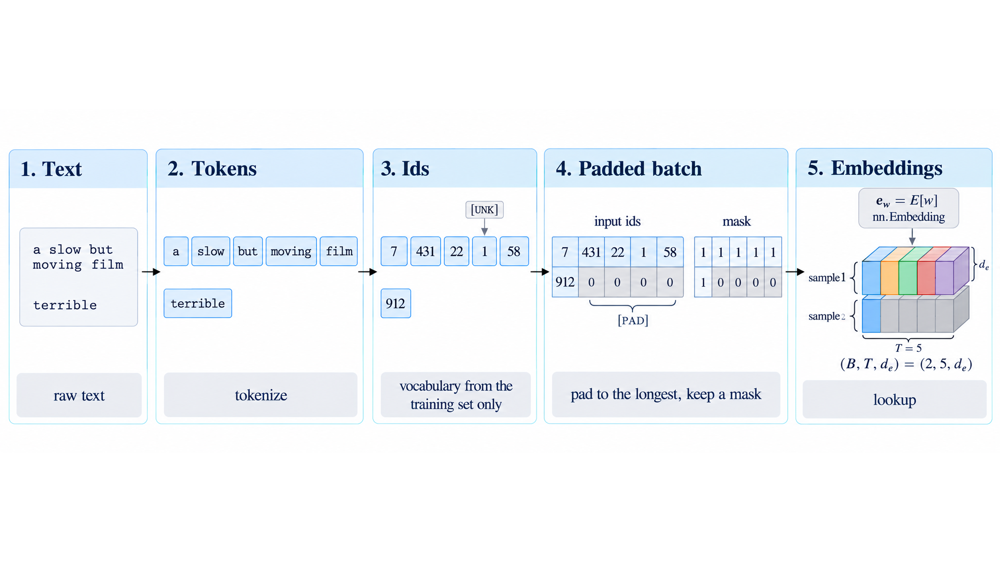

---

# Embeddings

$$
\mathbf e_w = E[w], \qquad E \in \mathbb R^{|V| \times d_e}
$$

`nn.Embedding(|V|, d_e)`: one-hot × matrix, done as a lookup (Session 04).

- learned **with the task**, from random;
- or initialized from word2vec or GloVe, trained on other text.

Distance in $E$ comes to mean "similar **for this task**".

---

# Batches of different lengths

Reviews have 10 words or 1 000.

- **pad** to the longest in the batch with `[PAD]`, and keep a **mask**;
- the model must ignore the padding: masked mean, or `pack_padded_sequence` for the LSTM;
- **truncate** long texts to a maximum length: a design choice to report;
- group similar lengths in a batch to waste less compute.

<span class="small">A classic silent bug: averaging embeddings including the padding. Short reviews get pulled toward the `[PAD]` vector.</span>

---

# Three classifiers, same budget

| Model | Sees order? | Reads |
|---|---|---|
| bag of embeddings | no | $\frac{1}{T}\sum_t \mathbf e_{w_t}$ → linear layer |
| 1-D CNN over embeddings | locally, $k$ words | filters over windows of $k$ words, max over time |
| LSTM | all of it | $\mathbf h_T$ (or a pooling of every $\mathbf h_t$) |

Same embedding size, same training budget, IMDB (25 000 reviews for training, 25 000 for test).

---

<!-- _class: figure -->
<!-- _paginate: false -->
<!-- _footer: "" -->


---

# What the embedding learned

After training on sentiment, look at the nearest neighbors of a few words in $E$ (cosine similarity, as in Session 04).

The neighbors are grouped by **polarity**, not by meaning: an adjective of praise sits next to other praise, whatever it describes.

An embedding is useful **for its task** (Session 04).

Pretrained GloVe instead (notebook 5.4, section 9): *actor* → actress, comedian; *boring* → tedious, dull, funny. Neighbors by **meaning**. Frozen, with 101 trainable parameters: 75.3 %; fine-tuned: 85.9 %.

---

<!-- _class: figure -->
<!-- _paginate: false -->
<!-- _footer: "" -->


<!-- Notebook 5.4, section 8: E of the bag-of-embeddings model (d = 64, 20 002 tokens). Colour: sign of w·e_w in the output layer. -->

---

# Prediction before experiment

IMDB. Shuffle the words of every **test** review; the models were trained on normal text.

<div class="twocol">

<div>

**Bag of embeddings:** what happens to its accuracy?

<span class="small">(Think about the formula before answering.)</span>

</div>

<div>

**LSTM:** how much does it lose?

What does the gap say about whether **order matters for sentiment**?

</div>

</div>

Answer in notebook 5.4.

---

# When order matters

Notebook 5.4, IMDB test set (25 000 reviews):

| | accuracy | words shuffled |
|---|---:|---:|
| bag of embeddings | **85.4 %** | 85.4 % |
| 1-D CNN | 84.1 % | 79.6 % |
| LSTM (3 epochs) | 82.6 % | 80.7 % |

Sentiment is close to a bag of words: which words appear says most of it.

Order matters for negation ("not good"), contrast ("good acting, but…"), irony, and anything with structure: dates, code, translation.

The **task** decides whether the order-aware model is worth its cost.

---

# The limit of a single vector

Many-to-one keeps only $\mathbf h_T$, or a pooling of all the $\mathbf h_t$.

For a sentiment score, one vector is enough.

For a **translation**, that one vector must carry the whole input sentence to a model that writes another one.

---

# Part 5 · Sequence to sequence and attention

1. Sequences as data — windows, splits and the baseline to beat
2. Recurrence and its gradients — one cell, many steps
3. Memory that lasts — LSTM and GRU
4. Text as a sequence — tokens, embeddings, order
5. **Sequence to sequence** — and the first form of attention

> Part 4: one vector summarizes the sequence. Enough to classify, not to rewrite.

---

# Encoder and decoder

**Encoder**: an RNN reads $\mathbf x_1, \dots, \mathbf x_T$ and ends in $\mathbf h_T$.

**Decoder**: another RNN starts from $\mathbf s_0 = \mathbf h_T$ and writes $y_1, \dots, y_{T'}$, one token at a time:

$$
\mathbf s_\tau = \text{RNN}(\mathbf s_{\tau-1}, \mathbf e_{y_{\tau-1}}),
\qquad
p(y_\tau \mid y_{<\tau}, \mathbf x) = \operatorname{softmax}(W_o \mathbf s_\tau)
$$

The encoder–decoder of Session 04, now in time. <span class="small">Sutskever, Vinyals & Le (2014); Cho et al. (2014).</span>

---

<!-- _class: figure -->
<!-- _paginate: false -->
<!-- _footer: "" -->

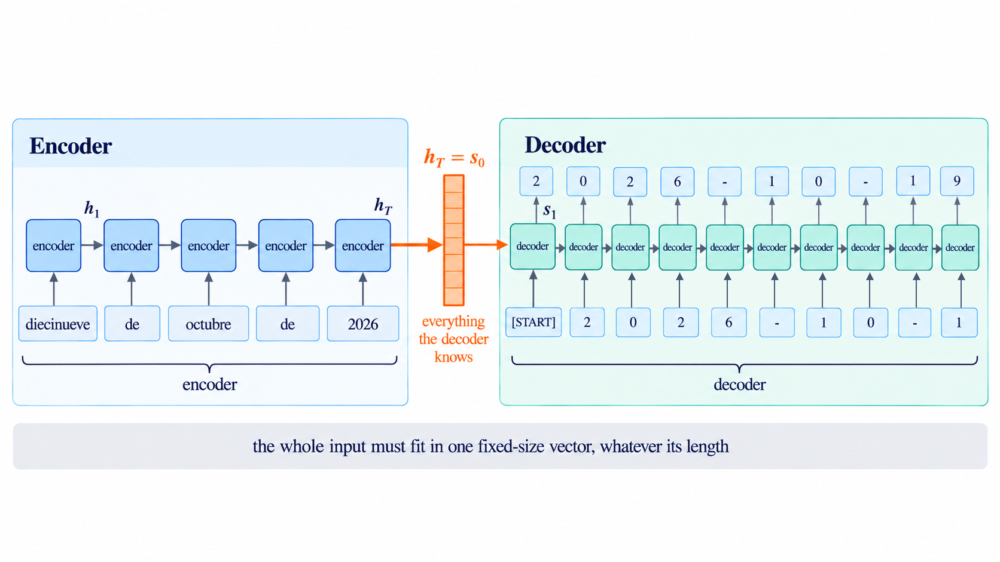

<!-- Generated image, patched by fix_s05_f08_seq2seq.py: the generator gave every decoder step a second, curved input from the previous chip. With teacher forcing each step receives only y_{tau-1}. -->

---

# Teacher forcing

**Training**: the decoder receives the **true** previous token $y_{\tau-1}$. All steps are trained in one pass; the loss is the cross-entropy of Session 01, summed over $\tau$.

**Inference**: it receives **its own** previous prediction. Errors accumulate: exposure bias.

Decoding: greedy (take the most likely token); beam search keeps the $k$ best partial outputs.


---

<!-- _class: figure -->
<!-- _paginate: false -->
<!-- _footer: "" -->

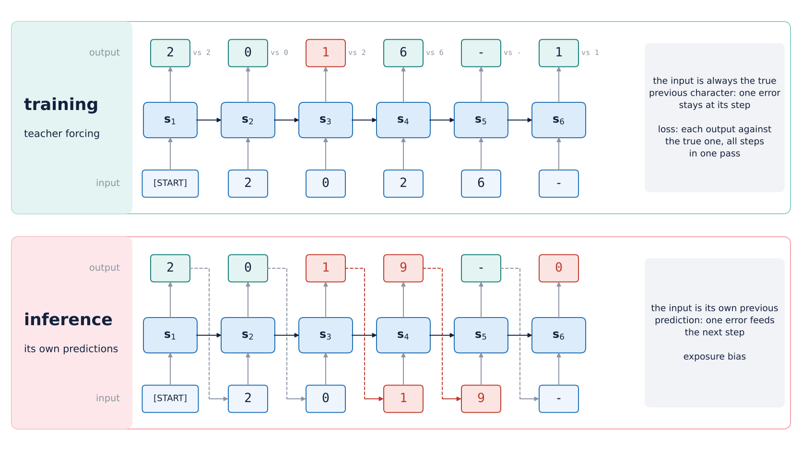

<!-- Script make_s05_f14_teacher_forcing.py, drawn (no data). The example date is 2026-10-19; the error at step 3 is illustrative. -->

---

# The bottleneck

Everything the decoder knows about the input passes through **one vector** $\mathbf h_T$, of fixed size, whatever the input length.

Translation quality of the plain encoder–decoder **falls with the length** of the sentence (Cho et al., 2014).

Part 2 again: the beginning of the input is many steps away from the end.

Notebook 5.5: dates inside sentences of 7–27 words. What limits the plain encoder–decoder there is the **size** of $\mathbf h_T$.

---

# Look back instead of remembering

At each output step $\tau$, the decoder **looks at every encoder state**:

$$
\alpha_{\tau t} = \operatorname{softmax}_t\big(\operatorname{score}(\mathbf s_{\tau-1}, \mathbf h_t)\big),
\qquad
\mathbf a_\tau = \sum_{t=1}^{T} \alpha_{\tau t}\, \mathbf h_t
$$

The context $\mathbf a_\tau$ changes at every output step and enters the decoder with $\mathbf e_{y_{\tau-1}}$.

<span class="small">Bahdanau, Cho & Bengio (2015).</span>

---

<!-- _class: media -->

# Attention in motion

<video controls preload="none" poster="../figures/s05_a03_seq2seq_attention_poster.png" aria-label="Attention in motion">
  <source src="../figures/s05_a03_seq2seq_attention.mp4" type="video/mp4">
</video>
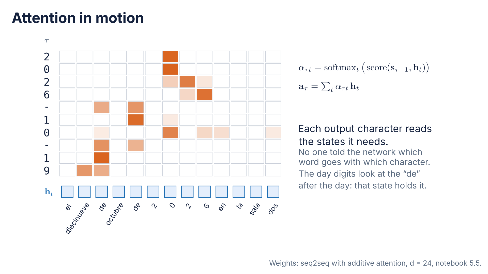

[Open animation](../figures/s05_a03_seq2seq_attention.mp4)

<!-- Decoding "el diecinueve de octubre de 2 0 2 6 en la sala dos" into 2026-10-19 with the weights of notebook 5.5 (the third panel of F09), row by row. -->

---

# Score functions

| Score | $\operatorname{score}(\mathbf s, \mathbf h)$ | Source |
|---|---|---|
| additive | $\mathbf v^\top \tanh(W_s \mathbf s + W_h \mathbf h)$ | Bahdanau et al. (2015) |
| dot product | $\mathbf s^\top \mathbf h$ | Luong et al. (2015) |
| scaled dot product | $\mathbf s^\top \mathbf h / \sqrt{d}$ | Vaswani et al. (2017) |

The scaled dot product is the one that survives in **Session 06**.

---

<!-- _class: figure -->
<!-- _paginate: false -->
<!-- _footer: "" -->

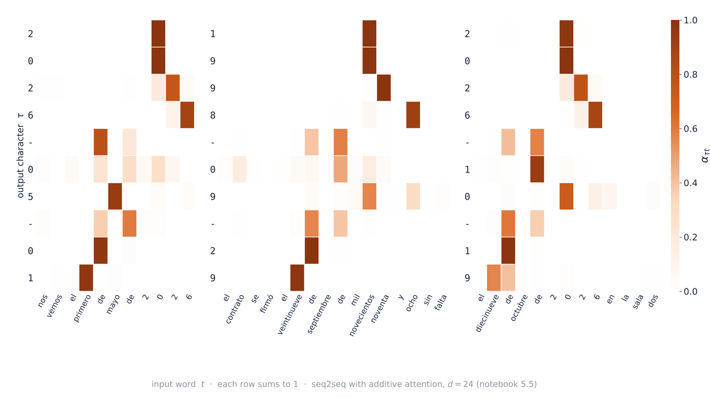

<!-- Notebook 5.5, section 6: seq2seq with additive attention, d = 24, 100 % exact accuracy on the test sentences. The day digits often look at the "de" after the day: attention picks states h_t, and with a left-to-right GRU the state at that "de" already holds the day. -->

---

# Prediction before experiment

Spanish sentences with a date in words → ISO date. Seq2seq **without** attention, same data, same training; only the size $d$ of $\mathbf h_T$ changes.

<div class="twocol">

<div>

With $d = 128$ it works. With $d = 24$, which part of the date is lost first: the **year**, the **month** or the **day**?

</div>

<div>

Same $d = 24$, **with** attention. Better, worse, or the same?

</div>

</div>

Answer in notebook 5.5.

---

# What attention changed

Notebook 5.5, exact accuracy on 6 000 test sentences:

| | $d = 24$ | $d = 128$ |
|---|---:|---:|
| without attention | 0.4 % | 93 % |
| with attention | **100 %** | — |

- without attention, the **day** goes first as $d$ shrinks (read first, written last); at $d = 24$ the month goes too;
- with attention the decoder reaches **any input state directly**: path length 1 instead of $T$;
- the weights read as an **alignment**, with care: attention picks **states** $\mathbf h_t$, not words, and the state at "de" already holds the day.


---

<!-- _class: figure -->
<!-- _paginate: false -->
<!-- _footer: "" -->

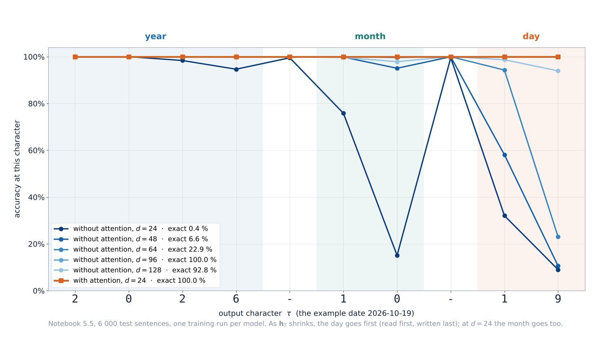

<!-- Script make_s05_figuras_notebooks.py (F13), from resultados_seq2seq.json of notebook 5.5. One run per model: d = 96 (100 %) above d = 128 (92.8 %) is run-to-run noise, not a trend. -->

---

# Keep the attention, drop the recurrence?

The encoder is still recurrent: step $t$ waits for step $t-1$, so training cannot run the steps in parallel.

If every step can look at every other step directly…

> …is the recurrence still needed? **Session 06.**

---

# Practice B — Text and sequence to sequence

Worked notebook in class, and an optional one at home:

- [5.4 · Text and embeddings](../notebooks/sesion_05_4_texto_embeddings.ipynb): vocabulary from train, padding and masks, bag of embeddings vs 1-D CNN vs LSTM, shuffled words, neighbors in $E$ · GPU
- *Optional, at home:* [5.5 · Seq2seq and attention](../notebooks/sesion_05_5_seq2seq_atencion.ipynb): dates in sentences → ISO, without attention at $d = 128$ and $d = 24$, with attention at $d = 24$, the attention map, how big $\mathbf h_T$ must be · CPU, ~7 min

> Write down for each text model: parameters, test accuracy, accuracy with shuffled words.

---

# Integrating exercise — Bike Sharing

[5.6 · Integrating exercise](../notebooks/sesion_05_6_integrador_bike_sharing.ipynb) · hourly bike rentals, weather and calendar

- temporal split and windows **without leakage**;
- your recurrent model (LSTM or GRU), logged to **MLflow**;
- MAE at 1, 6, 12 and 24 hours ahead, against two baselines: *the same as now* and *the same hour yesterday*;
- `forecast_raw`: a forecast from raw hourly records that rejects those that break the contract.

> How many hours ahead does your network still beat the obvious answer?

---

# Choosing a sequence model

| Model | Sees | Parameters grow with $T$? | Enough when |
|---|---|---|---|
| baseline | the last value (or season) | — | always the first row of the table |
| MLP on the window | $T$ steps, no order | yes | short windows, few variables |
| 1-D CNN | a receptive field | no | local patterns |
| RNN | everything, fading | no | short dependencies |
| LSTM / GRU | everything, kept | no | long dependencies |
| seq2seq + attention | every input step, at every output step | no | output is another sequence |

---

# What each choice assumes

| | Assumes | Pays with |
|---|---|---|
| the window | the past beyond $T$ does not matter | what happened before $T$ |
| the RNN | the past fits in $\mathbf h_t$ | the fading gradient |
| the LSTM | gates can learn what to keep | 4× the RNN parameters, sequential training |
| bag of embeddings | order does not matter | negation, structure |
| attention | any step may matter for any output | a weight for every pair of steps |

---

<!-- _class: figure -->
<!-- _paginate: false -->
<!-- _footer: "" -->


<!-- Generated image, patched by fix_s05_f10_summary.py: removed a "T = 8" label (T is the window length in this deck) and reversed the RNN ribbon, so its thickness reads as the weight of each step in y-hat, as the gradient of F03 and A01. The attention line thicknesses are an example of learned weights, not a rule. -->

---

# Exit question

A hospital has two years of hourly bed occupancy and wants a **48-hour** forecast.

Choose two and justify:

- a commonsense baseline with the weekly pattern;
- an LSTM with a 48-hour window;
- an LSTM with a 2-week window;
- a bidirectional LSTM over the window;
- first check that the split keeps the last months for test.
