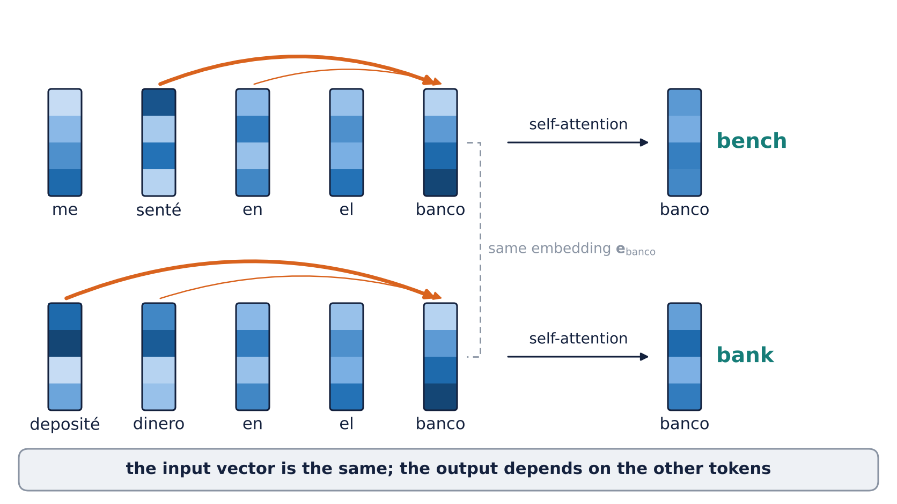
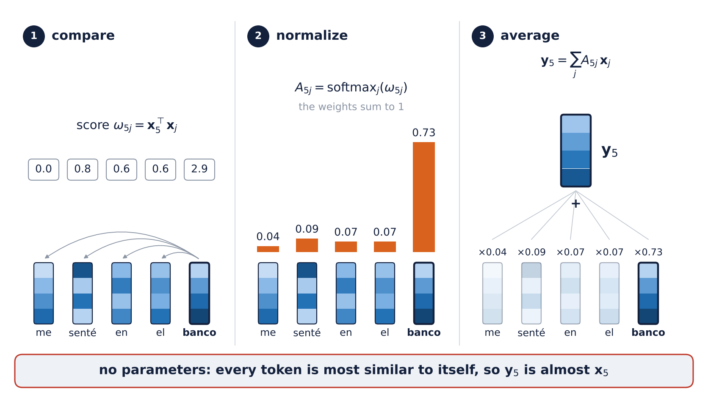
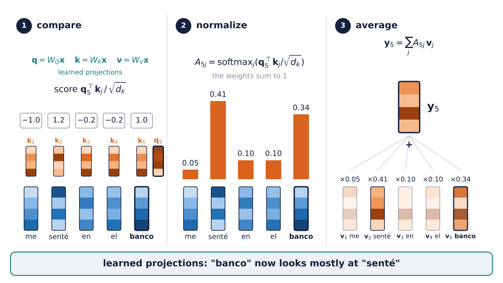
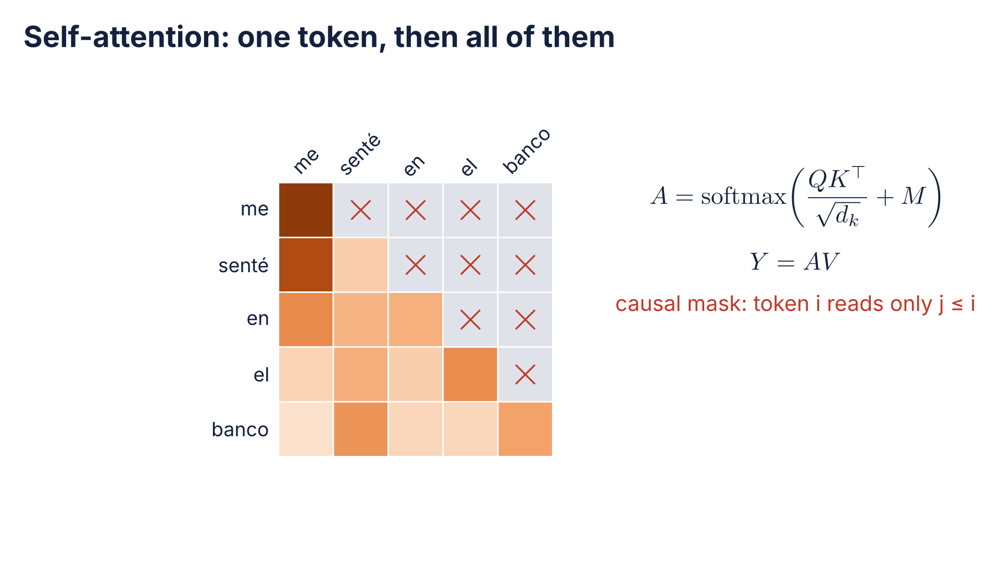
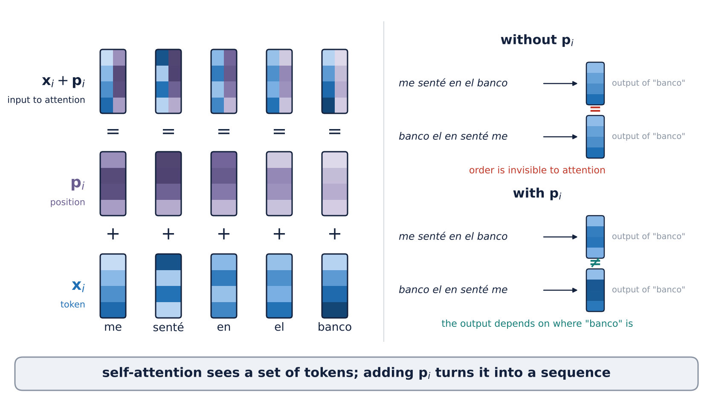
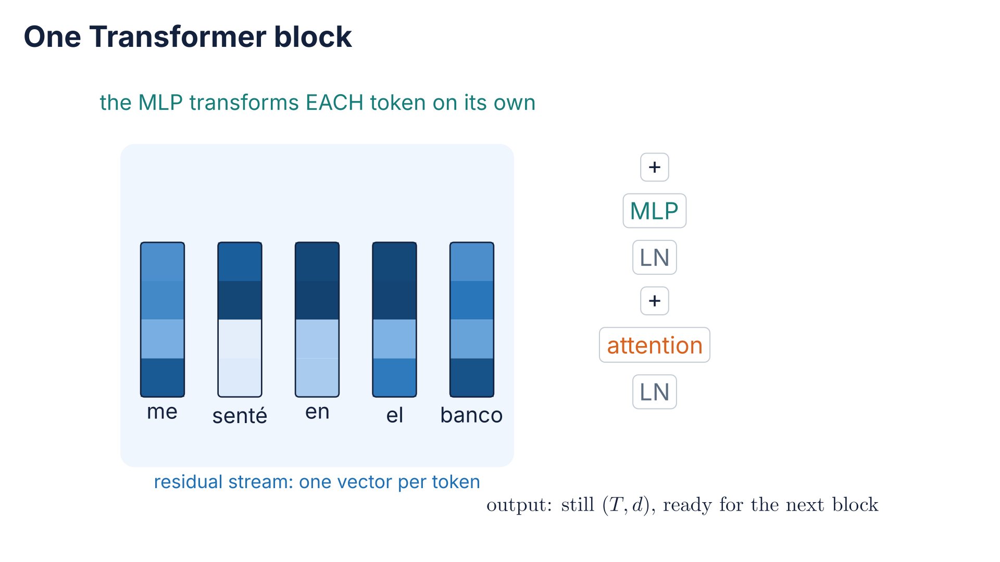
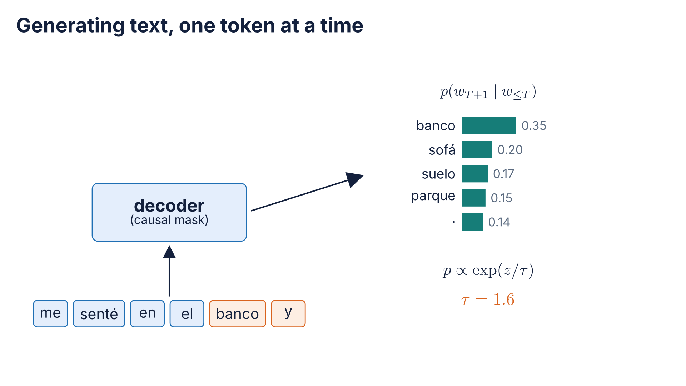
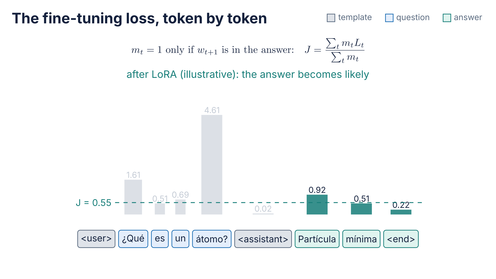

# What if we keep the attention and drop the recurrence?

<div class="center">

$$
X
\rightarrow
\operatorname{softmax}\!\left(\frac{QK^\top}{\sqrt{d_k}}\right)V
\rightarrow
\text{block}^{\times D}
\rightarrow
p_\theta(w_{t+1}\mid w_{\le t})
\rightarrow
\text{adapt}
$$

</div>

---

# Roadmap

1. Self-attention in full — heads, masks, position, cost
2. The Transformer block — attention plus everything from Session 02
3. Pretraining — tokens, next-token prediction, masked prediction
4. Scale and foundation models — text, images, time series, tables
5. Using a pretrained model — zero-shot, frozen, fine-tuned, LoRA

Practice A after Part 2; Practice B after Part 5.

---

# Where Session 05 left us

Sequence to sequence with attention: at every output step the decoder **reads every encoder state** directly.

But the encoder is still an RNN:

- step $t$ waits for step $t-1$: training does not parallelize along $T$;
- inside the encoder, two distant words are still $T$ steps apart.

---

# The question for today

> **What if we keep the attention and drop the recurrence?**

- If every token can read every other token, is the recurrence needed at all?
- And once we have such a model, what happens when we train it on a lot of text?

---

# Part 1 · Self-attention in full

1. **Self-attention in full** — heads, masks, position, cost
2. The Transformer block — attention plus everything from Session 02
3. Pretraining — tokens, next-token prediction, masked prediction
4. Scale and foundation models — text, images, time series, tables
5. Using a pretrained model — zero-shot, frozen, fine-tuned, LoRA

> Session 05: attention was a lookup from the **decoder** into the **encoder**. Today every token looks into its **own** sequence.

---

# From cross-attention to self-attention

**Session 05:** the decoder state $\mathbf s_{\tau-1}$ asked; the encoder states $\mathbf h_t$ answered.

**Now:** every token asks **every token of the same sequence**, itself included. The simplest version, with no parameters at all:

$$
\omega_{ij} = \mathbf x_i^\top \mathbf x_j,
\qquad
A_{ij} = \operatorname{softmax}_j(\omega_{ij}),
\qquad
\mathbf y_i = \sum_{j=1}^{T} A_{ij}\,\mathbf x_j
$$

Compare, normalize, average. The weights depend on the **content** of the tokens, not on a fixed neighborhood (Session 03).

---

<!-- _class: figure -->
<!-- _paginate: false -->
<!-- _footer: "" -->



<!-- Drawn by make_s06_f01_f05_tokens.py. The output columns are the weighted averages of the token vectors with the weights of F03 (0.05, 0.41, 0.10, 0.10, 0.34) and with 0.38, 0.12, 0.08, 0.08, 0.34 for the second sentence. Ask: what makes the two outputs differ, if the input vector is the same? -->

---

<!-- _class: figure -->
<!-- _paginate: false -->
<!-- _footer: "" -->



<!-- Illustrative scores; the weights are their softmax and y5 is computed from the drawn vectors. The point: x_i·x_i is usually the largest score, so without parameters each token mostly reads itself. -->

---

# Query, key, value

Without parameters, $\mathbf x_i^\top\mathbf x_i$ is usually the largest score: each token mostly reads **itself**, and the similarity is the same for every task.


Give each token three roles, each with its own **learned** projection:

| Role | Matrix | Question it answers |
|---|---|---|
| **query** | $Q = XW_Q$ | what am I looking for? |
| **key** | $K = XW_K$ | what do I offer to be found by? |
| **value** | $V = XW_V$ | what do I hand over if I am chosen? |

Row $i$ of $X$ is token $\mathbf x_i$, as in Session 03.

A **soft dictionary lookup**: compare the query with every key, return a mixture of the values.

---

<!-- _class: figure -->
<!-- _paginate: false -->
<!-- _footer: "" -->



<!-- Same layout as the previous figure, to compare them side by side. Illustrative scores; weights and y5 are computed. W_Q, W_K, W_V are random in the script: the figure shows the mechanism, not a trained model. -->

---

# Scaled dot-product attention

$$
\operatorname{Attention}(Q,K,V)
=
\underbrace{\operatorname{softmax}\!\left(\frac{QK^\top}{\sqrt{d_k}}\right)}_{A\ \in\ \mathbb R^{T\times T}}
V
$$

- $S = QK^\top/\sqrt{d_k}$: all $T^2$ scores in **one matrix product**;
- softmax **row by row**: row $i$ is a distribution over the tokens that $i$ reads;
- the dot-product score of Session 05, now for every pair at once.

```python
S = Q @ K.transpose(-2, -1) / math.sqrt(d_k)   # (T, T)
A = S.softmax(dim=-1)                           # each row sums to 1
Y = A @ V                                       # (T, d_k)
```

---

<!-- _class: media -->

# Self-attention in motion

<video controls preload="none" poster="../figures/s06_a01_self_attention_poster.png" aria-label="Self-attention in motion">
  <source src="../figures/s06_a01_self_attention.mp4" type="video/mp4">
</video>


[Open animation](../figures/s06_a01_self_attention.mp4)

<!-- "banco" compares its query with every key (scores -1.0, 1.2, -0.2, -0.2, 1.0, those of F03), softmax gives 0.05, 0.41, 0.10, 0.10, 0.34, and the weights average the values. Then every row at once as one T x T matrix, and the causal mask turns off the upper triangle and renormalizes each row. W_Q, W_K, W_V are random in the scene: it shows the mechanism, not a trained model. Rendered with escenas_s06.py. -->

---

# Why divide by $\sqrt{d_k}$?

If the entries of $\mathbf q$ and $\mathbf k$ are independent with mean 0 and variance 1:

$$
\operatorname{Var}\!\big(\mathbf q^\top\mathbf k\big)
=
\sum_{m=1}^{d_k}\operatorname{Var}(q_m k_m)
=
d_k
$$

With $d_k = 64$ the scores have standard deviation 8: the softmax **saturates**, one weight near 1, the rest near 0, and its gradient vanishes.

Dividing by $\sqrt{d_k}$ brings the variance back to 1. The same variance argument as **initialization** in Session 02.

---

# Multi-head attention

One head computes **one** pattern of who reads whom. Use $H$ heads of width $d_k = d/H$:

$$
\operatorname{head}_h = \operatorname{Attention}\big(XW_Q^{(h)}, XW_K^{(h)}, XW_V^{(h)}\big),
\qquad
\operatorname{MHA}(X) = \big[\operatorname{head}_1, \dots, \operatorname{head}_H\big]\,W_O
$$

- each head can attend to a different relation (the next word, the subject, a closing bracket);
- **same parameters and cost** as one head of width $d$: $4d^2$ in total;
- like several kernels in one convolutional layer (Session 03).

In code, heads are a reshape: `(B, T, d) → (B, H, T, d_k)`.

---

<!-- _class: figure -->
<!-- _paginate: false -->
<!-- _footer: "" -->


<!-- Generated image, patched by fix_s06_f04_multihead.py: the generator wrote softmax(QK^T/d_k) without the square root, and drew the concatenation as three stacked horizontal bands (which reads as stacking rows); it is now three vertical strips 1, 2, H, side by side along the features. Point at the three different attention patterns: each head learns its own relation. -->

---

# Masks

$$
A = \operatorname{softmax}(S + M),
\qquad
M_{ij} =
\begin{cases}
0 & \text{if } i \text{ may read } j\\
-\infty & \text{otherwise}
\end{cases}
$$

$e^{-\infty} = 0$: a masked position gets weight exactly 0, and the row still sums to 1.

- **Padding mask:** no token reads `[PAD]` (Session 05: batches of different lengths).
- **Causal mask:** token $i$ reads only $j \le i$. The model cannot see the future, which is what a generator needs.

```python
causal = torch.ones(T, T).triu(diagonal=1).bool()   # True above the diagonal
S = S.masked_fill(causal, float('-inf'))
```

---

# Prediction before experiment

A self-attention layer **without** positional information. Feed it a sentence, then the same tokens in a shuffled order.

<div class="twocol">

<div>

**No mask:** what happens to the outputs when the inputs are shuffled?

</div>

<div>

**Causal mask:** and now?

</div>

</div>

Answer in notebook 6.1.

<!-- Measured in notebook 6.1, section 6: without a mask the outputs are the same vectors, shuffled the same way (torch.allclose: True; the Session 03 permutation test). With the causal mask they change (False), because which tokens each position can read depends on the order; but only through which tokens are visible, not through where they are. With x + p they change too: the output of "banco" moves by 0.50 between the two orders, against 0.0000 without position (slide 20, F06). -->

---

# Order has to be added

Without position, self-attention is **permutation-equivariant**: shuffle the inputs and the outputs are shuffled the same way.

Session 03 (patches) and Session 05 (shuffled words) showed why that matters.

Add a vector $\mathbf p_i$ for each position: $\ \mathbf x_i \leftarrow \mathbf x_i + \mathbf p_i$

| | How | Where |
|---|---|---|
| learned | one trained vector per position | ViT (Session 03), BERT, GPT-2 |
| sinusoidal | fixed sines and cosines of different frequencies | the original Transformer (Vaswani et al., 2017) |
| rotary (RoPE) | rotate $\mathbf q$ and $\mathbf k$ by an angle that depends on the position | most current LLMs |

---

<!-- _class: figure -->
<!-- _paginate: false -->
<!-- _footer: "" -->



<!-- The right half is real parameter-free self-attention, softmax(X X^T) X, computed in the script on the drawn vectors: without p the outputs of the shuffled sentence are the same vectors shuffled (asserted in the script); with p they are not. -->

---

<!-- _class: figure -->
<!-- _paginate: false -->
<!-- _footer: "" -->

![bg contain Measured in notebook 6.1. Top: the attention matrix of one head for "me senté en el banco" plus two padding tokens, with no mask, with a padding mask (the two [PAD] columns get weight 0) and with padding plus causal mask (everything above the diagonal gets weight 0; "me" can only read itself). Bottom: the output of "banco" for the sentence and for the same tokens shuffled; without position the two outputs are identical, difference 0.0000; with position they differ, 0.4989](../figures/s06_f06_masks_permutation.png)

<!-- Drawn by make_s06_figuras_notebooks.py from atencion_mascaras.npz (notebook 6.1, sections 5-6). This is the answer to the prediction two slides back. -->

---

# The cost of attention

Every head of every layer computes a $T \times T$ matrix of scores.

| Context $T$ | Scores per head per layer |
|---:|---:|
| 512 | 262 144 |
| 1 024 | 1 048 576 |
| 2 048 | 4 194 304 |

**Doubling the context quadruples** the attention time and memory.

That is the price of letting any token read any token directly. Fused kernels (FlashAttention) cut the memory, not the $T^2$ compute. Measured in notebook 6.1.

---

# Recurrence vs attention

Per layer, sequence of $T$ tokens of width $d$ (Vaswani et al., 2017):

| | Recurrent layer | Self-attention layer |
|---|---|---|
| compute | $T\,d^2$ | $T^2\,d$ |
| sequential steps | $T$ | $1$ |
| longest path between two tokens | $T$ | $1$ |

Attention wins on **parallelism** and **path length**: the two problems of Session 05.

It loses when $T$ is much larger than $d$.

---

# Part 2 · The Transformer block

1. Self-attention in full — heads, masks, position, cost
2. **The Transformer block** — attention plus everything from Session 02
3. Pretraining — tokens, next-token prediction, masked prediction
4. Scale and foundation models — text, images, time series, tables
5. Using a pretrained model — zero-shot, frozen, fine-tuned, LoRA

> Part 1: attention **mixes** tokens. By itself it is a weighted average, linear in $V$. It needs a nonlinearity, depth and a way to train that depth.

---

# Two sublayers

$$
\begin{aligned}
X &\leftarrow X + \operatorname{MHA}\big(\operatorname{LN}(X)\big) && \text{mixes information } \textbf{across} \text{ tokens}\\
X &\leftarrow X + \operatorname{MLP}\big(\operatorname{LN}(X)\big) && \text{transforms } \textbf{each} \text{ token on its own}
\end{aligned}
$$

Attention is the only new piece.

Everything else is from Session 02: residual connections, LayerNorm, an MLP, GELU.

---

# Pre-norm and the clean residual path

**LayerNorm** (Session 02): normalizes each token over its $d$ features, not over the batch. It works the same in training and inference, and for any $T$.

**Pre-norm:** LN goes **inside** each branch, before the sublayer. The residual path from input to output is a pure sum, as promised in Session 02:

$$
X_D = X_0 + \sum_{l=1}^{D} F_l(\cdot)
$$

**Post-norm** (the original paper) puts LN **on** the residual path; deep stacks then need a careful warmup to train (Xiong et al., 2020).

---

# The MLP and GELU

$$
\operatorname{MLP}(\mathbf x) = W_2\,\varphi(W_1\mathbf x + \mathbf b_1) + \mathbf b_2,
\qquad
W_1 \in \mathbb R^{4d \times d},\ W_2 \in \mathbb R^{d \times 4d},\ \varphi = \text{GELU}
$$

Applied to every token separately, with the **same** weights: a per-token network.

It holds $8d^2$ of the block's $12d^2$ parameters: **two thirds**.

GELU, from Session 02: $\ \varphi(z) = z\,\Phi(z)$.

---

<!-- _class: figure -->
<!-- _paginate: false -->
<!-- _footer: "" -->


<!-- Generated image, patched by fix_s06_f07_block.py: the two update formulas were garbled, the input was a lowercase x, and the post-norm inset placed attention on the residual path; the inset is redrawn. Point at the blue band: in pre-norm nothing sits on it, so the gradient has an identity path through every block (Session 02). In post-norm, an LN sits on it after every block. -->

---

<!-- _class: media -->

# The block in motion

<video controls preload="none" poster="../figures/s06_a02_block_poster.png" aria-label="The block in motion">
  <source src="../figures/s06_a02_block.mp4" type="video/mp4">
</video>


[Open animation](../figures/s06_a02_block.mp4)

<!-- Five token vectors in the residual stream. LN, then attention: arrows between columns (only weights above 0.12 drawn) and every column changes. LN, then MLP: one small box per column, no arrows between them. The same (T, d) comes out. Random weights; colors squashed with tanh so the three stages are comparable. Rendered with escenas_s06.py. -->

---

<!-- _class: figure -->
<!-- _paginate: false -->
<!-- _footer: "" -->


<!-- Generated image, patched by fix_s06_f08_whole_gpt.py: the generator sent the ids of "el" and "banco" into the position embedding; every id goes to the token embedding, and the position table is indexed by t. Walk the shapes from bottom to top; the next slide counts the parameters of each box. Probabilities are illustrative. -->

---

# Counting parameters

Per block, ignoring biases and LayerNorm:

$$
\underbrace{4d^2}_{W_Q,\,W_K,\,W_V,\,W_O}
+
\underbrace{8d^2}_{W_1,\,W_2}
=
12d^2
$$

GPT-2 small: $d = 768$, 12 blocks, vocabulary of 50 257, context of 1 024.

| Part | Parameters |
|---|---:|
| 12 blocks: $12 \times 12d^2$ | 84.9 M |
| token embedding $\lvert V\rvert \cdot d$ | 38.6 M |
| position embedding $1024 \cdot d$ | 0.8 M |
| **total** | **≈ 124 M** |

Notebook 6.2 checks the formula against `sum(p.numel() for p in model.parameters())`.

---

# Three architectures

| | Mask | Reads | Typical use | Examples |
|---|---|---|---|---|
| **encoder** | none (padding only) | the whole input | understand an input | BERT, ViT |
| **decoder** | causal | the past | generate, one token at a time | GPT |
| **encoder-decoder** | none in the encoder, causal in the decoder, plus **cross-attention** | the input and the output so far | input sequence → output sequence | original Transformer, T5 |

The encoder-decoder is the seq2seq of Session 05 without recurrence: cross-attention is the Bahdanau attention.

---

<!-- _class: figure -->
<!-- _paginate: false -->
<!-- _footer: "" -->


<!-- Generated image, used as is. Count the causal mask with the class: row i has i orange cells. The decoder outputs are its inputs shifted left by one: that shift is the whole training signal of Part 3. The encoder-decoder is the seq2seq of Session 05 with attention everywhere and no recurrence; cross-attention is the Bahdanau attention. -->

---

# Prediction before experiment

The **dates task** of Session 05: Spanish sentences with a date in words → ISO date.

<div class="twocol">

<div>

**S05, notebook 5.5:** GRU encoder-decoder with additive attention, $d = 24$: 100 % exact.

</div>

<div>

**Now:** a 2-layer Transformer encoder-decoder, $d = 64$.

</div>

</div>

- Which one takes less time per epoch?
- Which one reaches 100 % in fewer epochs?
- And the Transformer **without** positional embeddings?

Answer in notebook 6.2.

<!-- Measured in notebook 6.2 (CPU, 2 cores; the S05 model retrained on the same machine): both reach ~100 % exact at epoch 2 (S05 0.998, Transformer 0.999). Per epoch the Transformer was SLOWER here, 38 s vs 16 s: it has 15x the parameters (246 k vs 16 k), sentences are at most 27 tokens, and a CPU barely parallelizes. Use it: the advantage of slide 22 is how time grows with T on parallel hardware, not this number. Without positional embeddings: 66 % exact, errors on digits 3-4 of the year ("1 9 8 3" and "1 9 3 8" are the same set of tokens); the dashes stay perfect because the causal mask tells the decoder how many tokens precede it. Post-norm, 6 layers, no warmup, lr 3e-3: 0.6 % exact after epoch 1 vs 99.7 % for pre-norm (98.4 % after epoch 2). -->

---

# Training a Transformer

The Session 02 recipe, with two emphases:

- **AdamW**, learning-rate **warmup** then cosine decay;
- dropout on the attention weights and on each residual branch;
- gradient clipping (Session 05).

Warmup matters more than in a CNN: early Adam steps are large, and large updates to $W_Q, W_K$ can push the scores into the saturated softmax of V13.

---

# What the Transformer changed

- **No recurrence:** all positions in parallel during training.
- **Path length 1** between any two tokens.
- **One block** for text, images (ViT, Session 03), audio and time series: only the tokenizer changes.

What it costs:

- $T^2$ in time and memory;
- no built-in notion of **order** or **locality**: both must be added or learned from data.

---

# Practice A — Attention and the block

Worked notebooks, one change per cell:

- [6.1 · Self-attention](../notebooks/sesion_06_1_autoatencion.ipynb) · CPU: five lines of attention checked against `F.scaled_dot_product_attention`; $\sqrt{d_k}$; heads; masks; permutation with and without position; time and memory vs $T$
- [6.2 · The Transformer block](../notebooks/sesion_06_2_bloque_transformer.ipynb) · CPU/GPU: the pre-norm block; parameters vs $12d^2$; the dates task of 5.5 with a Transformer; without position; post-norm without warmup

> Write down for 6.2: parameters, time per epoch, epochs to 100 %, for the S05 model and each Transformer.

---

# Part 3 · Pretraining

1. Self-attention in full — heads, masks, position, cost
2. The Transformer block — attention plus everything from Session 02
3. **Pretraining** — tokens, next-token prediction, masked prediction
4. Scale and foundation models — text, images, time series, tables
5. Using a pretrained model — zero-shot, frozen, fine-tuned, LoRA

> Part 2: a block that trains in parallel and fits any sequence. Session 04: unlabeled data can **supervise itself**.

---

# Subword tokens

| Unit | Vocabulary | Sequence length | Unknown words |
|---|---|---|---|
| words (Session 05) | very large | short | `[UNK]` |
| characters | ~100 | long, and attention costs $T^2$ | none |
| **subwords (BPE)** | chosen, e.g. 32 000 | in between | none |

**Byte-pair encoding:** start from bytes; count adjacent pairs in the training text; merge the most frequent pair into a new token; repeat until the vocabulary has the chosen size.

Frequent words end up as one token; rare words split into two or three pieces. Notebook 6.3 prints how the tokenizer of a real model (Qwen2.5, about 151 000 tokens) splits Spanish.

---

<!-- _class: figure -->
<!-- _paginate: false -->
<!-- _footer: "" -->


<!-- Script figure (make_s06_f10_bpe.py). The corpus is the Spanish text of the course notebooks, 148 000 characters, so the figure needs no download. Frequent words of that corpus (de, que, el, del, leer) become one token; "banco" and "periódico" split because the corpus is small and about deep learning. Below 1 character per token at 256: é and ó take two bytes each. Notebook 6.3 shows the same idea with the 151 000 tokens of Qwen2.5. -->

---

# Next-token prediction

$$
J(\theta) = -\frac{1}{T-1}\sum_{t=1}^{T-1} \log p_\theta\big(w_{t+1} \mid w_1, \dots, w_t\big)
$$

At every position, a cross-entropy over the whole vocabulary: the classification loss of Session 01, with $|V|$ classes.

The labels are **the text itself, shifted by one**. Nobody annotates anything: self-supervision, as in Session 04.

---

# Masked prediction for text

**BERT** (Devlin et al., 2019): hide 15 % of the tokens and predict them from **both** sides.

Session 04: images need about 75 % masked, text only 15 %. A word is much harder to guess from its neighbors than a pixel patch.

| | Next token (GPT) | Masked (BERT) |
|---|---|---|
| architecture | decoder, causal mask | encoder, no mask |
| sees | the left context | both sides |
| good for | generating | representations for classification |

---

<!-- _class: figure -->
<!-- _paginate: false -->
<!-- _footer: "" -->

![bg contain How BERT hides words, in four steps: 1, the input "me senté en el banco"; 2, 15 percent of the tokens are chosen, here "senté"; 3, the chosen token becomes [MASK] 80 percent of the time, a random word such as "perro" 10 percent, and stays "senté" 10 percent; 4, the sentence with [MASK] goes into an encoder with no mask, attention brings left and right context to the [MASK] position, and the prediction "senté ?" there is the only place where the loss is computed](../figures/s06_f11_bert_masking.png)

<!-- Generated image, patched by fix_s06_f11_bert_masking.py: panel 4 was upside down (the encoder below the tokens, arrows going into the tokens); it is redrawn bottom to top. Ask: why replace 10 % with a random word and keep 10 % unchanged? Because at fine-tuning there is no [MASK]: the model must not learn that only [MASK] positions matter (the bottom strip). -->

---

# The causal mask makes training parallel

One forward pass over a sequence of $T$ tokens gives **$T$ predictions** and **$T$ losses** at once, each one seeing only its own past.

```python
logits = model(tokens)                         # (B, T, |V|), causal mask inside
loss = F.cross_entropy(
    logits[:, :-1].reshape(-1, V),             # position t predicts...
    tokens[:, 1:].reshape(-1))                 # ...token t+1
```

**Training** is parallel along $T$. **Generation** is still one token at a time: the next input is the token just produced.

---

<!-- _class: figure -->
<!-- _paginate: false -->
<!-- _footer: "" -->


<!-- Generated image, used as is. Read the mask row by row: row t has t orange cells, so prediction t never sees the token it must predict. Training: one pass, T losses. Generation: T passes, one token each, which is why generation is slow and training is not (next slide: the animation). -->

---

<!-- _class: media -->

# Generating text

<video controls preload="none" poster="../figures/s06_a03_generation_poster.png" aria-label="Generating text">
  <source src="../figures/s06_a03_generation.mp4" type="video/mp4">
</video>


[Open animation](../figures/s06_a03_generation.mp4)

<!-- Prompt "me senté en el": a distribution over the next token (banco 0.46, illustrative), sample, append, the window grows; the next distribution is that of F08 (y 0.31, de 0.22 ...). Then the same logits at tau = 0.5 (banco 0.73) and tau = 1.6 (0.35): temperature only rescales the logits. Rendered with escenas_s06.py. -->

---

# Sampling

From the logits $\mathbf z$ of the last position:

| Rule | Next token |
|---|---|
| greedy | $\arg\max_w z_w$ |
| temperature $\tau$ | sample from $\operatorname{softmax}(\mathbf z/\tau)$ |
| top-$k$ / top-$p$ | sample only among the $k$ most likely, or the smallest set with probability $p$ |

The temperature plays the same role as in InfoNCE (Session 04): small $\tau$ sharpens the distribution.

Low $\tau$: safe and repetitive. High $\tau$: varied and incoherent.

---

# Prediction before experiment

**Qwen2.5-0.5B, the base model:** 494 M parameters, pretrained on about 18 trillion tokens with the next-token loss and nothing else.

Prompt:

`Usuario: ¿Qué es un átomo?⏎Asistente:`

- Does it answer the question?
- Does it **stop** after answering?

Answer in notebook 6.3, section 3.

<!-- Measured in notebook 6.3 (Kaggle T4, greedy, 120 tokens): it answers, it does not stop. "¿Qué es un átomo?" gives one sentence about protons and electrons repeated until the limit; two other questions repeat too; "Dame tres ideas..." even starts like an assistant ("¡Claro! Aquí tienes..."). Of 12 held-out questions it stopped by itself on 3. Continuing text and answering are different tasks: that is what SFT changes (Part 5). -->

---

<!-- _class: figure -->
<!-- _paginate: false -->
<!-- _footer: "" -->


<!-- Measured in notebook 6.3 (Kaggle T4). The base model often starts a sensible answer, and sometimes even sounds like an assistant ("¡Claro! Aquí tienes...": Qwen's pretraining data contains chat-like text), but it does not know where an answer ends: it repeats itself until the limit. Of 12 held-out Dolly questions, it stopped by itself on 2. The átomo answer even drifts into Chinese ("电子", electron) before correcting itself. -->

---

# What pretraining learns

To predict the next token well, a model has to learn, from the text alone:

- spelling and grammar;
- facts stated in the text;
- some patterns of reasoning that the text contains.

Nobody labels any of it.

GPT-2 (Radford et al., 2019): one model pretrained on web text did several tasks (summaries, translation, questions) **without** being trained for them.

---

# Part 4 · Scale and foundation models

1. Self-attention in full — heads, masks, position, cost
2. The Transformer block — attention plus everything from Session 02
3. Pretraining — tokens, next-token prediction, masked prediction
4. **Scale and foundation models** — text, images, time series, tables
5. Using a pretrained model — zero-shot, frozen, fine-tuned, LoRA

> Part 3: next-token prediction turns any text into supervision. How much text, and how big a model?

---

# Scaling laws

Test loss falls as a **power law** in the number of parameters $N$, the training tokens $D$ and the compute $C$, over many orders of magnitude (Kaplan et al., 2020):

$$
L(N) \approx \left(\frac{N_c}{N}\right)^{\alpha_N},
\qquad
\alpha_N \approx 0.08
$$

A straight line on log-log axes: **predictable** gains, with small exponents. Ten times more parameters lowers the loss by a constant factor, not to zero.

---

<!-- _class: figure -->
<!-- _paginate: false -->
<!-- _footer: "" -->


<!-- Drawn by make_s06_f14_scaling.py from the published fit L(N, D) = E + A/N^alpha + B/D^beta with C = 6ND (Hoffmann et al. 2022, coefficients re-estimated by Besiroglu et al. 2024; the original approach-3 fit gives 40-100 tokens per parameter, inconsistent with the paper's other two approaches). Read it in three steps: a fixed model flattens (more data stops helping a small model); the envelope is the straight-ish power law of the previous slide; Gopher sits above the envelope because it is too big for its data. -->

---

# Compute-optimal training

Training a Transformer costs about

$$
C \approx 6\,N\,D \ \text{ FLOPs}
$$

(2 for the forward pass, 4 for the backward, per parameter and per token).

For a fixed budget $C$, grow $N$ and $D$ **together**: about **20 tokens per parameter** (Hoffmann et al., 2022).

Chinchilla, 70 B parameters on 1.4 T tokens, beat models four times larger trained on less data.

---

# What is a foundation model?

> Trained on **broad data at scale**, usually with self-supervision, and then **adapted** to many downstream tasks (Bommasani et al., 2021).

- It is a **pattern of training and use**, not an architecture.
- A Transformer is not a foundation model by itself; a Transformer pretrained on the web and reused for a hundred tasks is.
- The ImageNet backbone of Session 03 was an early, small version of the same idea.

---

# Beyond text: vision

**CLIP** (Radford et al., 2021): 400 M image–caption pairs, trained with InfoNCE (Session 04). The positive pair is an image and **its caption**.

**Zero-shot classification:** embed the image; embed one text per class, "a photo of a {class}"; pick the closest text. No training on the task.

**DINO, MAE** (Session 04): vision backbones pretrained without labels, used through probes or fine-tuning.

---

<!-- _class: figure -->
<!-- _paginate: false -->
<!-- _footer: "" -->


<!-- Measured in notebook 6.4 (Kaggle T4). Zero-shot is four times chance with no labels, and the wording of the class text moves it by 4 points: prompt engineering, which already uses validation labels. A linear probe on the very same CLIP image features with 1 % of the labels (about 190 images) jumps to 86 %: the information is in the features; the class texts do not reach it, because satellite photos are rare among web captions. CLIP features also beat ImageNet ones at both label fractions. -->

---

# Beyond text: time series and tables

**Chronos** (Ansari et al., 2024): scale each series, quantize its values into a fixed set of bins, treat the bins as tokens, and train a language model on many series (real and synthetic). Forecast by **sampling** future tokens: several possible futures, not one number.

**TabPFN** (Hollmann et al., 2023): a Transformer pretrained on millions of **synthetic** tables. For a new small table it predicts in one forward pass, with the training rows as context.

Both are used **zero-shot**: no gradient step on your data.

---

# Zero-shot is a claim to check

A foundation model may never have seen data like yours:

- satellite bands that are not RGB;
- a hospital's bed occupancy, a factory's sensors;
- Spanish clinical notes.

The **baseline still has to be beaten** (Session 05: the commonsense forecast). A pretrained model that loses to "tomorrow equals today" is not useful, however large.

---

# Prediction before experiment

<div class="twocol">

<div>

**EuroSAT, 10 classes**

- CLIP zero-shot
- CLIP features + linear probe, 10 % of the labels
- ImageNet ResNet-18 probe (Session 03), 10 % of the labels; and your SimCLR probe (Session 04)

</div>

<div>

**Bike Sharing, 24 h ahead**

- commonsense baseline: the same hour yesterday
- Chronos zero-shot, history only
- your LSTM from the Session 05 exercise, with weather

</div>

</div>

Which one comes out ahead in each case? Answer in notebook 6.4 (optional, at home).

<!-- Measured in notebook 6.4 (Kaggle T4, validation split of S03/S04). EuroSAT: CLIP zero-shot 36.5 % with the folder names, 37.4 % with "a photo of ...", 40.8 % with "a satellite photo of ..." (chance 10 %). A linear probe on the same CLIP image features: 86.0 % with 1 % of the labels, 93.0 % with 10 %; ImageNet ResNet-18 probe: 79.6 % and 87.8 %. The information is in the CLIP features; the class texts do not reach it. Compare with the students' S04 SimCLR table. Bike Sharing, with the windows, cuts and horizons of the S05 integrator (5.6), MAE in bikes per hour at 1 / 6 / 12 / 24 h. Validation (Jul-Sep 2012): best baseline 84 / 84 / 83 / 83 (the same as in 5.6, a check that the protocol matches); reference 5.6 solution, GRU 32 with weather and calendar, 37 / 51 / 52 / 58; Chronos-Bolt-small zero-shot, demand only, 30 / 42 / 43 / 42. Test (Oct-Dec): best baseline 76 / 76 / 76 / 77, Chronos 26 / 42 / 43 / 46, its 10-90 % interval holds the truth 83 % of the time. So Chronos, never trained on this series and without weather, beats the baseline by 40-65 % and the reference GRU at every horizon. Caveats to raise: Chronos reads 512 hours, the GRU 72 (Tu turno 3 gives Chronos 72), and the GRU is the small reference solution, not a tuned one. -->

---

# The cost of size

**Training:** a frontier model needs compute only a few labs can pay for.

**Inference memory:** parameters × bytes per parameter.

| Model | 16-bit weights |
|---:|---:|
| 124 M (GPT-2 small) | 0.25 GB |
| 7 B | 14 GB |
| 70 B | 140 GB |

Most practitioners **use** foundation models; they do not train them. So: how to use one?

---

# Part 5 · Using a pretrained model

1. Self-attention in full — heads, masks, position, cost
2. The Transformer block — attention plus everything from Session 02
3. Pretraining — tokens, next-token prediction, masked prediction
4. Scale and foundation models — text, images, time series, tables
5. **Using a pretrained model** — zero-shot, frozen, fine-tuned, LoRA

> Part 4: pretrained models exist for text, images, series and tables. The question now is **how much of one to train**.

---

# Four ways to use it

| | Trains | Cost | When |
|---|---|---|---|
| **zero-shot** | nothing | one forward pass | no labels; check against a baseline |
| **frozen features + probe** | the head | seconds, features cached | few labels, domain close to pretraining |
| **fine-tuning** | everything | memory for all gradients | enough labels, or a distant domain |
| **PEFT (LoRA)** | a few added parameters | a fraction of fine-tuning | limited memory, many tasks |

The three strategies of Sessions 03 and 04, plus one.

---

<!-- _class: figure -->
<!-- _paginate: false -->
<!-- _footer: "" -->


<!-- Generated image, used as is. The arrow spans the first three; LoRA sits outside it on purpose: it trains few parameters but changes every layer, which frozen features cannot do. Ask which of the four needs a copy of the whole model per task (only fine-tuning). -->

---

# Frozen features

Run the encoder **once** over the data and cache $\mathbf h$:

- the output of the `[CLS]` token, or the mean of all token outputs (masking the padding);
- then train a linear layer on the cached vectors, in seconds.

```python
with torch.no_grad():
    h = encoder(**batch).last_hidden_state[:, 0]   # [CLS]
```

Cheap and robust with few labels; limited by what pretraining put into $\mathbf h$ (Session 04: probes measure exactly that).

---

# Fine-tuning

All weights trainable, with the Session 03 recipe:

- a **small learning rate**, $10^{-5}$ to $5\cdot 10^{-5}$;
- warmup, so the random head does not wreck the pretrained weights;
- few epochs: the model starts close to a good solution.

The best choice with enough labels or a distant domain.

The cost: gradients and AdamW state for **every** weight, about 4× the memory of the weights alone, and a full copy of the model per task.

---

# LoRA, in one slide

Freeze $W_0 \in \mathbb R^{d \times d}$. Learn a **low-rank** update:

$$
W = W_0 + B A_r,
\qquad
B \in \mathbb R^{d \times r},\ A_r \in \mathbb R^{r \times d},\ r \ll d
$$

- trainable values: $2dr$ instead of $d^2$; with $d = 768$, $r = 8$: **12 288 vs 589 824, 2 %**;
- $B$ starts at zero, so training starts from the pretrained model exactly;
- after training, merge $W_0 + BA_r$: inference costs nothing extra.

In practice: `peft.LoraConfig(r=8, lora_alpha=16, target_modules=[...])`.

(Hu et al., 2021.) $A_r$ carries a subscript: $A$ is the attention matrix.

---

<!-- _class: figure -->
<!-- _paginate: false -->
<!-- _footer: "" -->

![bg contain From fine-tuning to LoRA in three steps. 1, fine-tuning: y = W x with W, d by d, updated by W plus Delta W from backpropagation; d squared trained values. 2, the same in two paths: y = W_0 x + Delta W x, with W_0 frozen and Delta W trained, both d by d; still d squared trained values. 3, LoRA: Delta W replaced by B A_r, with A_r of r by d and B of d by r, through an r by 1 vector; 2 d r trained values. With d = 768 and r = 8, 2dr = 12 288 versus d squared = 589 824, 2 percent; after training W = W_0 + B A_r, no extra cost at inference](../figures/s06_f17_lora.png)

<!-- Generated image, used as is. Step 2 changes nothing in the computation, only how it is written: that rewriting is what makes step 3 possible. Ask why B starts at zero (the first forward pass is exactly the pretrained model). -->

---

# From a language model to an assistant

A pretrained language model **continues** text. Ask it a question and it may write three more questions.

Three stages:

1. **Pretraining** (Part 3): next token on a huge corpus.
2. **Supervised fine-tuning (SFT):** next token on (question, answer) pairs.
3. **Preference tuning** (RLHF, DPO): learn from which of two answers people prefer. One line today.

A **chat template** turns a pair into one sequence of tokens with role markers:

`<user> ¿Qué es un átomo? <assistant> Partícula mínima <end>`

**Notebook 6.3** is stage 2 in miniature: a base model and 2 000 Spanish (question, answer) pairs. The integrating exercise then teaches a **style**.

---

# The next-token loss, token by token

`<user>` ¿Qué es un átomo? `<assistant>` Partícula mínima `<end>`

<div class="twocol">

<div class="small">

| $t$ | target $w_{t+1}$ | $p(\text{target})$ | $L_t$ |
|---:|---|---:|---:|
| 1 | ¿Qué | 0.20 | 1.61 |
| 2 | es | 0.60 | 0.51 |
| 3 | un | 0.50 | 0.69 |
| 4 | átomo? | 0.01 | 4.61 |
| 5 | `<assistant>` | 0.98 | 0.02 |
| 6 | Partícula | 0.05 | 3.00 |
| 7 | mínima | 0.10 | 2.30 |
| 8 | `<end>` | 0.30 | 1.20 |

</div>

<div>

Logits $Z \in \mathbb R^{T \times |V|}$. Position $t$ reads tokens $1, \dots, t$ and predicts token $t+1$:

$$
L_t = -\log \operatorname{softmax}(\mathbf z_t)_{w_{t+1}}
$$

A cross-entropy over the vocabulary at every position (Session 01).

9 tokens give 8 predictions: the last one has nothing to predict.

</div>

</div>

<!-- Illustrative probabilities, chosen to show the pattern of a base model: the template token after the question is almost free (0.02), the question word "átomo?" is hard to guess (4.61), the styled answer is new to the model. Real templates use model-specific markers; notebook 6.3 uses plain text, "Usuario:" and "Asistente:" (a base model has no chat template), shows which tokens get a label in TRL's batches and prints this table for one real pair. -->
---

<!-- _class: media -->

# The loss in motion

<video controls preload="none" poster="../figures/s06_a04_masked_loss_poster.png" aria-label="The loss in motion">
  <source src="../figures/s06_a04_masked_loss.mp4" type="video/mp4">
</video>


[Open animation](../figures/s06_a04_masked_loss.mp4)

<!-- The example of the previous slide. Each position predicts the next token; L_t = -log p(target) as bars over the target. Mean over all 8: 1.74, dominated by "átomo?", a word of the question. The mask greys template and question: J = 2.17. After LoRA (illustrative probabilities 0.40, 0.60, 0.80) the answer bars shrink to J = 0.55. Rendered with escenas_s06.py. -->

---

# Loss only on the answer

Mask $m_t = 1$ if the target $w_{t+1}$ belongs to the answer (including `<end>`, so the model learns to stop), $0$ otherwise:

$$
J = \frac{\sum_t m_t\,L_t}{\sum_t m_t}
$$

<div class="twocol">

<div>

**Without the mask:** $J = 13.94 / 8 = 1.74$.

The largest term is "átomo?" (4.61): the model would learn to **predict the user's question**. The template (0.02) dilutes the rest.

</div>

<div>

**With the mask:** $J = (3.00 + 2.30 + 1.20)/3 = 2.17$.

Only the answer counts. In TRL: `completion_only_loss=True`.

</div>

</div>

<div class="small">

```python
L = F.cross_entropy(logits[:, :-1].reshape(-1, V), tokens[:, 1:].reshape(-1), reduction="none")
J = L[mask[:, 1:].reshape(-1)].mean()      # one L_t per position, mean over the answer only
```

</div>

---

<!-- _class: figure -->
<!-- _paginate: false -->
<!-- _footer: "" -->


<!-- Measured in notebook 6.3. The question is expensive (" Constit" 8.4 nats: nobody can guess what will be asked, but "ución" is then free) and so is the newline that opens the template (8.6, its first appearance; slide 69 made it almost free, which holds once the template is familiar). Inside the answer the first word is the hardest (" Prote" 10.1: many ways to start), the rest of a word is free ("ge", "icos", "oun id enses" near 0), " estad" costs 7.6 and the end token 6.4: the base model does not expect the answer to end there. Without the mask the mean is 3.36, pulled up by the question; with the mask, J = 2.82. -->

---

# Prediction before experiment

**Notebook 6.3:** Qwen2.5-0.5B base; LoRA with $r = 16$ on $W_Q, W_K, W_V, W_O$ of its 24 blocks, **2.16 M trainable values, 0.44 %**; 2 000 Dolly pairs in Spanish; one epoch, 250 steps.

- Held-out masked NLL: from what to what?
- Of 12 held-out questions, on how many does the model **stop** by itself, before and after?
- Does it learn new facts, or a new format?

Answer in notebook 6.3, sections 7–8.

<!-- Measured in notebook 6.3 with TRL's SFTTrainer (Kaggle T4: 118 s of training, 2.3 GB peak, 2 162 688 trainable values, 0.44 %). Held-out masked NLL 2.060 → 1.903 (perplexity 7.8 → 6.7), 85 % of the drop in the first 50 of 250 steps (1.926 at step 50). Stops by itself on 2 of 12 held-out questions before, 9 of 12 after. Format, not facts: "Clasifica estos animales..." comes back as a clean list, but it says "Ballena: aves" and "Gorrion: mamífero"; "tres ideas para ahorrar agua" gives three short items, two of them the same odd idea; the clima answer still repeats until the limit. The átomo answer is no more correct than before, only shorter and it ends. -->

---

# Measuring a style

**Held-out NLL:** the same masked $J$ on test pairs, with no gradient. Lower is better.

$\exp(J)$ is the **perplexity**: roughly, among how many tokens the model is hesitating at each step. In the example, $e^{2.17} \approx 8.7$.

Compare three conditions on the same test questions:

1. the base model;
2. the base model, with the style asked for in the prompt;
3. the base model with LoRA.

Only compare NLL between models with the **same tokenizer**: with other tokens, the sum runs over other units.

An LLM acting as judge is easier to read and harder to trust: optional.

---

# Comparing fairly

- The same data split, the same number of steps or the same compute.
- Several seeds where they are cheap.
- Next to accuracy: **trainable parameters**, training time and peak memory.

The data contract for text: the **tokenizer** and the **maximum length** are part of the model, and travel with it.

---

# Prediction before experiment

IMDB with **2 000** training reviews.

| Model | Accuracy? | Trainable parameters? |
|---|---|---|
| LSTM (Session 05) | | |
| DistilBERT frozen + probe | | |
| DistilBERT fine-tuned | | |
| DistilBERT + LoRA | | |

Rank them by accuracy. Rank them by trainable parameters. Do the two rankings agree?

Answer in notebook 6.5.

<!-- Measured in notebook 6.5 (Kaggle T4, 2 000 test reviews): LSTM 77.6 %, 4.2 M trainable; DistilBERT frozen + probe 84.2 %, 1 538 trainable; fine-tuned 89.1 %, 66.4 M; LoRA 88.9 %, 149 k (0.22 %). By accuracy: fine-tuning ≈ LoRA > probe > LSTM. By trainable parameters: probe < LoRA < LSTM < fine-tuning. The rankings do not agree, and the LSTM trains 28 times more parameters than LoRA while losing by 11 points. Time 6 / 7 / 42 / 31 s; peak memory 0.2 / 2.1 / 3.4 / 2.7 GB. For scale, Session 05 (notebook 5.4) with 20 000 training reviews: bag of embeddings 85.4 %, 1-D CNN 84.1 %, LSTM 82.6 %; DistilBERT with a tenth of the labels is above all of them. -->

---

# When to use what

| Situation | First try |
|---|---|
| no labels at all | zero-shot, checked against a baseline |
| few labels, domain close to pretraining | frozen features + probe |
| enough labels, or a distant domain | fine-tuning |
| limited memory, or many tasks on one base | LoRA |

Always with a **baseline** in the first row of the table.

---

# Practice B — Adapting pretrained models

In class, GPU (Kaggle T4, about 15 + 10 minutes):

- [6.3 · Supervised fine-tuning](../notebooks/sesion_06_3_ajuste_supervisado.ipynb): Qwen2.5-0.5B base on 2 000 Spanish pairs of Dolly-15k with TRL's `SFTTrainer` and `peft` LoRA; which tokens count; the same questions before and after

- [6.5 · A pretrained BERT](../notebooks/sesion_06_5_adaptacion.ipynb): what DistilBERT learned (`[MASK]`, "bank" in context); IMDB with 2 000 reviews: LSTM from scratch, DistilBERT frozen + probe, fine-tuned and with LoRA (one `Trainer`); accuracy, parameters, time, memory

Optional, at home:

- [6.4 · Foundation models](../notebooks/sesion_06_4_modelos_fundacionales.ipynb): CLIP on EuroSAT, Chronos on Bike Sharing

> Write down for 6.3: held-out NLL before and after, and on how many of the 12 questions the model stops by itself. For 6.5: one row per model.

---

# Integrating exercise — Does it need fine-tuning?

[6.6 · Integrating exercise](../notebooks/sesion_06_6_integrador_estilo_llm.ipynb) · a pretrained LLM that must answer in the Spanish of *Don Quijote*

- a model that already converses (Qwen2.5-0.5B **Instruct**): 6.3 showed where that comes from;
- the `SFTTrainer` and LoRA of 6.3, now with the model's chat template and answers written in one style;
- a fixed budget logged to **MLflow**; held-out NLL for base, base with the style in the prompt, and LoRA;
- `responder_raw`: an answer from a raw question that respects the contract.

> Is asking for the style in the prompt enough, or does the model have to be fine-tuned?

<span class="tiny">Adapted from MIT 6.S191, Lab 3 (MIT License).</span>

---

# The course in six questions

| Session | Question | What it added to the loop $x \rightarrow f_\theta(x) \rightarrow L \rightarrow \nabla_\theta L \rightarrow \theta'$ |
|---|---|---|
| 01 | How does a network learn? | the loop itself: loss, gradient, update |
| 02 | Why can we train deep networks? | initialization, normalization, residuals, optimizers |
| 03 | How does data structure shape the network? | architecture as an assumption: convolution, patches |
| 04 | Can a network learn without labels? | the objective chooses the representation |
| 05 | How does a network remember the past? | recurrence, gates, attention over time |
| 06 | What if we keep the attention and drop the recurrence? | pretraining at scale, then adapting |

---

# What each choice assumes

| | Assumes | Pays with |
|---|---|---|
| self-attention | any token may matter for any other | $T^2$ time and memory |
| no position | order does not matter | everything order carries |
| pretraining | the pretraining data resembles yours | errors where it does not |
| zero-shot | the task is already in the model | no way to correct it without labels |
| frozen features | the representation already fits the task | the gap a probe cannot close |
| LoRA | the needed update is low rank | a little accuracy, sometimes |

---

<!-- _class: figure -->
<!-- _paginate: false -->
<!-- _footer: "" -->

![bg contain Test accuracy against trainable parameters on IMDB with 2 000 training reviews, log scale. DistilBERT frozen plus probe: 1 538 trainable parameters, 84.2 percent. DistilBERT with LoRA: 149 thousand, 88.9 percent. LSTM from scratch: 4.2 million, 77.6 percent. DistilBERT fine-tuned: 66 million, 89.1 percent. Hollow, for reference: the Session 05 models trained on 20 000 reviews, bag of embeddings 85.4, 1-D CNN 84.1, LSTM 82.6 percent, about 1.3 million parameters each. Time and peak memory: LSTM 6 s and 0.2 GB, probe 7 s and 2.1 GB, fine-tuning 42 s and 3.4 GB, LoRA 31 s and 2.7 GB](../figures/s06_f19_summary.png)

<!-- Measured in notebook 6.5 (Kaggle T4). The summary of Part 5 in one picture: pretraining is worth 7 to 11 points over the LSTM with 2 000 labels; LoRA gets within 0.2 points of full fine-tuning with 0.22 % of its trainable parameters; the probe is the cheapest and 5 points behind. The LSTM trains more parameters than LoRA and is the worst: the number of trainable parameters is not what buys accuracy, the pretrained weights are. Hollow diamonds: the Session 05 models of notebook 5.4, trained on 10 times more labels (20 000 reviews) and tested on the full 25 000; fine-tuned DistilBERT and LoRA with 2 000 labels beat all three by 3.5 to 6.5 points (different test samples, so read it as a few points, not to the decimal). -->

---

# Exit question

A clinic has **800 labeled Spanish clinical notes** (3 classes) and **one 16 GB GPU**.

Choose two and justify:

- an LSTM trained from scratch;
- a multilingual encoder, frozen, plus a probe;
- full fine-tuning of the same encoder;
- LoRA on a 7 B decoder;
- ask a chat LLM zero-shot, and compare it with a baseline on a held-out set.
